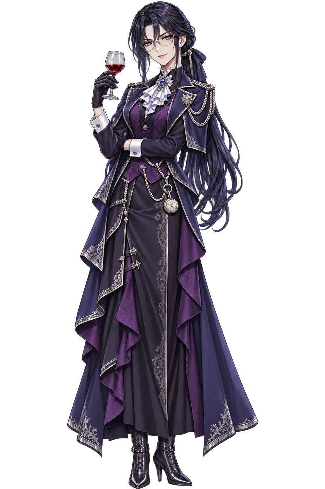
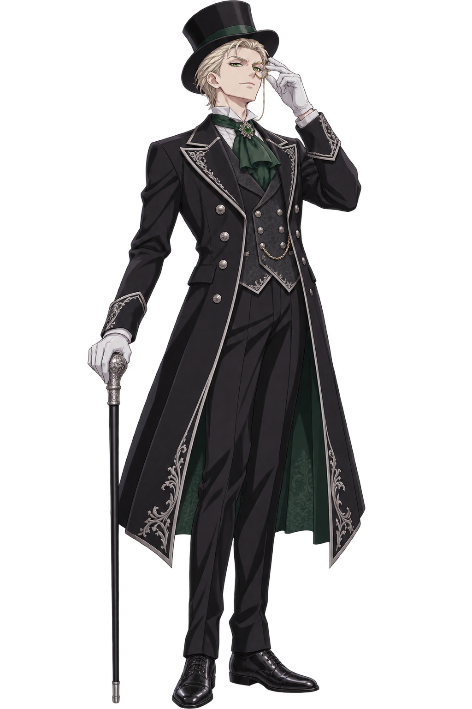
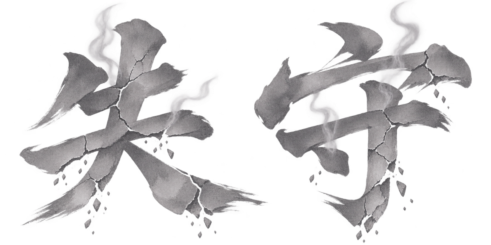

# 《狐耳摩斯》第一作 遊戲企劃案

Nov 5, 2026 · @Ji Yen Fu

《狐耳摩斯》（Sherefox）是一款維多利亞蒸氣龐克背景的 2D 偵探 AVG：玩家用證物拉出推理鏈，在「論戰」中比誰的鏈更自洽，並沿著十二章、四條牽扯線一路揭開幕後宿敵 Wolfhart 的陰謀。本企劃以已定設計與 GDD v1.0 為準，標示【提案】者為本企劃新增、可刪改的建議。

**文件結構**：本分頁為設計總覽；系統細則與介面文本見 系統規格，逐案數值試算見 數值總表，十五個案件的完整設計見 各章設計，全劇本見 完整劇本。

美術方向見 美術風格。

## 一、一頁概要

一句話：\*\*「真相不一定贏，自洽的推理鏈才會贏。」\*\*狐耳偵探 Sherefox 在十二章、十五場主線論戰裡，用推理鏈擊破對手的主張，並把每一次正確推理化成黃金線索，帶到終章擊穿宿敵 Wolfhart 的「完全自洽之壁」。

| 項目 | 內容 |
| --- | --- |
| 專案代號 | Shereware ／ Sherefox 第一作 |
| 類型 | 2D AVG 綜合玩法・偵探推理 |
| 題材與風格 | 奇幻蒸氣龐克、維多利亞時代倫敦，輕小說與推理漫畫節奏（ACG 感） |
| 主角 | Sherefox，19 歲狐耳女偵探 |
| 篇幅 | 12 章（Ch.9 連鎖案件含 4 個連續案件），共 15 個案件、15 場主線論戰 |
| 遊玩時數 | 首輪約 20～25 小時；True End 約 30 小時【提案】 |
| 平台 | PC（Steam）首發，主機版後續評估【提案】 |
| 語言 | 繁體中文、日文、英文【提案】 |
| 目標玩家 | 喜歡推理 AVG、角色互動與輕小說敘事的 ACG 玩家【提案】 |

### 三大賣點

1. **自洽論戰**：勝負看推理鏈是否自洽，不看是否正確。每回合雙方同時出招，讀懂對手的預兆決定攻守；實證穩、詭辯猛但留弱點，玩家要決定何時冒險。
2. **黃金線索陰謀鏈**：前半看似獨立的案件，正確推理會默默留下黃金線索；後半連鎖案件、選舉、宴會與終局逐一回收，第一輪沉默，二週目恍然大悟。
3. **雙向論破與尾聲翻轉**：論破不是終結技，而是把戰局推進「尾聲階段」的開關。對手會垂死反撲，宿敵會將計就計，玩家也能在絕境中反擊論破。

## 二、世界觀

舞台是蒸氣與發條驅動的維多利亞倫敦：霧、煤煙、銅管與鐘塔。蒸氣龐克主要體現在美術與證物（發條、壓力裝置、蒸氣義肢），社會結構則保留時代感。

- **獸耳亞人**：少數亞人種與人類混居。種族呼應角色定位：狐耳族直覺敏銳、狡黠（Sherefox）；犬耳族重階級、看似敏銳卻常找錯方向（巴斯克維爾）；Wolfhart 是純血人類（或刻意隱藏特徵），象徵絕對的理性與控制。
- **蒸氣科技**：蒸氣駁船、煤礦列車、劇院升降梯、全城蒸氣廣播、中央蒸氣發條塔。後期陰謀就是利用這些公共設施。
- **權力結構**：蘇格蘭場、內務部、貴族院、內閣與王室。Wolfhart 以「資助蘇格蘭場與市政建設的企業戰略顧問」身分滲透各層。
- **報紙**：每案以報紙頭條開場、以報紙結算。報紙寫的是世人眼中的結果，未必是真相，也是惡名值與輿論的載體。
- **主題**：世界本來就不是拿出真證據就能贏。他人認可的「真相」，是較自洽的那一方。

### 主要地點

| 地點 | 章節 | 用途 | 蒸氣龐克元素 |
| --- | --- | --- | --- |
| 貝克街偵探事務所 | 全章 | 日常主場景、Ch.1 蒐證、Ch.8 比對 | 蒸氣暖爐、傳聲管、亞瑟的工作台 |
| 樓下鐘錶店「報時鳥」 | Ch.2、8 | 日常場景、Wolfhart 喝咖啡的角落 | 大型報時鳥鐘、精密機芯櫃 |
| 蘇格蘭場 | 全章 | 警督辦公室、證物室 | 氣動傳送文件管 |
| 泰晤士河碼頭與蒸氣駁船 | Ch.3 | 反鎖鍋爐室命案 | 鍋爐、壓力閥、霧 |
| 皇家歌劇院 | Ch.4 | 升降梯事故、後台包廂 | 蒸氣升降梯、冷卻管線 |
| 孤兒院與後巷 | Ch.5 | 警督的秘密 | 修屋頂的發條吊臂 |
| 約克郡礦坑與金庫 | Ch.6 | 幽靈列車 | 運煤列車、自動巡航裝置、電報站 |
| 高地莊園 | Ch.7 | 暴風雪密室 | 蒸氣暖管、壁爐 |
| 東區地下印刷廠 | Ch.9-4 | 偽證工廠、情報站 | 蒸氣印刷機 |
| 海德公園演講台 | Ch.10 | 公開辯論 | 蒸氣擴音喇叭 |
| 白金漢宮宴會廳 | Ch.11 | 假面華爾滋 | 地底蒸氣管線 |
| 中央蒸氣發條塔 | Ch.12 | 終局 | 全城蒸氣廣播中樞 |

### 勢力

| 勢力 | 代表人物 | 立場 |
| --- | --- | --- |
| 狐耳偵探事務所 | Sherefox、亞瑟 | 真相優先，但也需要報紙與警方的信任 |
| 蘇格蘭場 | 巴斯克維爾警督 | 體制內的盟友，受內務部與資助方牽制 |
| 內務部 | 督察（Ch.9-1） | 部分人員被 Wolfhart 滲透 |
| 銀牙會（The Silver Fang） | Wolfhart、情報站長 | Wolfhart 的地下情報組織，徽記為狼頭；表面以企業顧問公司運作 |
| 貴族院與內閣 | 首席大臣 | 保守、懼怕醜聞外洩 |
| 學院派偵探 | 維多・克勞 | 競爭者，後半暫時結盟 |

### 年表

| 時間 | 事件 |
| --- | --- |
| 十年前 | Wolfhart 以企業養女身分奪權（G-06 卷宗的內容） |
| 1887 年 10 月 | Ch.1 亞瑟搬進事務所；Ch.2 鐘錶店事件 |
| 1887 年 11 月 | Ch.3 駁船命案；Ch.4 歌劇院事故 |
| 1887 年 12 月 | Ch.5 警督的休假日；Ch.6 約克郡出差 |
| 1888 年 1 月 | Ch.7 約克郡案後應伯爵之邀北上高地，回程途中受困暴風雪 |
| （時間推進約四個月） | 事務所接下蘇格蘭與歐陸的長期委託，倫敦在此期間悄悄變質 |
| 1888 年 5 月下旬 | Ch.8 回到倫敦（5 月 25 日）；Ch.9 四案自 5 月 31 日的帳房命案起，至 6 月 10 日連續發生 |
| 1888 年 6 月第 3 週 | Ch.10 議員選舉公開辯論 |
| 三天後 | Ch.11 女王宴會 |
| 當晚 | Ch.12 發條塔決戰 |

## 三、常駐角色

五位班底在日常與案件中反覆登場，每一位都綁定一項系統職能。亞瑟・潘德爾頓、巴斯克維爾警督、維多・克勞皆為正式名字。

> 〔圖表：角色關係圖〕此圖為線上主文件的互動圖表，Markdown 匯出無法保留，請見 https://claude.ai/artifact/LQDVV6KG7qX32iaqWw4Pv2

### Sherefox（主角）


19 歲狐耳女偵探。開朗愛惡作劇、喜歡雙關語與反諷，觀察力極強、擅長心理戰。情緒起伏時會摸耳朵或尾巴，推理時專注皺眉。口頭禪：「等一下，我快解開了！」外型為棕色偵探長大衣（內裡藏工具口袋）、胸前緞帶領結、獵鹿帽、放大鏡與筆記本。幼年被一位老偵探發掘並指導，目標是成為世界最知名的偵探。

- **系統職能**：玩家操作者。場景蒐證、線索板拉線、論戰同時出招的四種行動、【論破】與「狐耳直覺」與「絕境重組」。
- **弱點**：惡作劇有時過頭引起誤會，對應系統上的「惡名值」。

### Wolfhart（宿敵，莫瑞亞蒂位）



19 歲，表面是資助蘇格蘭場與市政建設的企業戰略顧問，實為地下情報主腦。曾是企業養女，後奪權上位。貴族式冷靜、控制慾極強，說話帶多重從句與被動語態，把批評包裝成客觀分析。喜歡黑咖啡、西洋劍與下棋，習慣背對窗戶坐。黑髮帶藍光、鋼灰色眼眸、細框眼鏡、左眼角一顆痣，穿墨藍／暗紫／深黑的西裝裙。外冷內熱：面對 Sherefox 時眼神會洩露情緒，被指出溫柔時會冷笑或微紅臉轉移話題。

- **日常藏法**：常駐熟面孔，偶爾在樓下鐘錶店或警局喝黑咖啡、暗中觀察 Sherefox。
- **系統職能**：每案在現場留下指向她的劇情證物；終章對手，主張鏈 100% 自洽，擅長「以退為進」（故意讓出小破綻換取致命反擊）。

### 亞瑟・潘德爾頓 Arthur（助手，華生位）


20 歲，與 19 歲的 Sherefox 同輩。17 歲時以戰地醫護兵身分派駐海外，在前線失去左前臂；退伍後自己打造蒸氣義肢，從此成為機械學徒／蒸氣義肢技師，醫療與機械兩種鑑定都來自這段經歷。務實的常人視角兼吐槽役，與主角同住事務所，是互相鬥嘴的同齡室友，而不是年長的監護者：打理三餐與帳務、吐槽她的惡作劇，並以筆記撰寫案件紀錄——遊戲旁白就是他的筆記。

- **專業鑑定**：解鎖屍檢（時間、死因）與精密機械（物理、地點）類證物的隱藏標籤。
- **弱點提示**：玩家在線索板拉出詭辯連結時會皺眉嘆氣。
- **論戰援護**：每場限 1 次（Ch.7 每段 1 次），由玩家決定何時使用，替玩家擋下設陷的暴擊。

### 巴斯克維爾警督 Baskerville（友方警官，暮木位）


蘇格蘭場犬耳族警督。威風凜凜、重紀律，常來事務所丟案子順便蹭飯。總是第一個到場、自信滿滿地抓錯嫌犯；主角破案後由他出面逮捕，順理成章登上頭版。私下重情義，Ch.5 揭露他悄悄照顧陣亡部下的孤兒院。

- **官方情報源**：依「信任度」提供驗屍報告、現場出入權與證人名單。
- **熱身對手**：正式案件開場的不扣血小論戰對象。

### 維多・克勞 Victor（對手偵探）



貴族出身的學院派偵探，講究完美主義與表面證據，看不起 Sherefox 的街頭心理戰，兩人亦敵亦友。Ch.4 首次交鋒、Ch.7 再戰、Ch.9 因同樣被 Wolfhart 擺了一道而先敵後友。

- **鏡像競爭者**：撿走玩家蒐證時漏掉的證物，論戰中以鏡像讀心預判玩家的下一手、用設陷狙擊詭辯，預兆偶爾偽裝；可對玩家發動【逆・論破】。

### 角色在案件六步驟的出場職能

| 角色 | 日常 | 遭遇事件 | 蒐證 | 推理 | 論戰 | 結算 |
| --- | --- | --- | --- | --- | --- | --- |
| 助手 | 同住、三餐、吐槽 | 陪同到場 | 醫療／機械鑑定 | 對詭辯皺眉 | 援護擋刀一次 | 寫下案件紀錄 |
| 警官 | 丟案子、蹭飯 | 先到場、先誤判 | 依信任度給情報 | — | 熱身對手／旁聽 | 逮捕、登報搶功 |
| 宿敵 | 以顧問身分偶遇 | — | 現場留下劇情證物 | — | 幕後操盤（終章親自登場） | 回收棋子、埋伏筆 |
| 對手偵探 | — | 先一步封鎖現場 | 撿走漏掉的證物 | — | 鏡像讀心、設陷狙擊詭辯 | 失意或交換情報 |

## 四、案件循環

每個案件照推理漫畫的節奏走六步，從日常出發、最後回到日常。日常小事件（Ch.1、2、5）與 Ch.9-2、9-3 走精簡版：單一場景蒐證＋一場論戰。

> 〔圖表：案件循環 · 六步驟〕此圖為線上主文件的互動圖表，Markdown 匯出無法保留，請見 https://claude.ai/artifact/LQDVV6KG7qX32iaqWw4Pv2

論戰是每案的高潮；不論勝敗都會進入結算，敗北只會讓下一案從較差的位置開始。案件來源有三種：委託人上門、警督帶來、出門時剛好遇上。

## 五、推理與證物系統

推理就是在證物之間拉線：系統靠屬性標籤判斷連結成不成立，靠「歸類理由」判斷推理對不對。選錯理由也能參戰，只是只能拉詭辯線。

### 證物三級

| 等級 | 可否參戰 | 用途 |
| --- | --- | --- |
| 一般證物 | 可 | 組成推理鏈與連鎖攻擊的主要材料 |
| 關鍵證物 | 可 | 歸類理由推理正確時，系統默默收進對應的黃金線索（不跳提示），並計入 True End 條件 |
| 劇情證物 | 不可 | 解鎖對話隱藏選項、改變結算時的人物關係與信任度；指向 Wolfhart 的痕跡在二週目回看更明顯 |

### 證物卡資料結構

| 欄位 | 內容 | 範例 |
| --- | --- | --- |
| ID 與名稱 | 程式辨識用 | `E02_Gear` 缺齒的黃銅齒輪 |
| 等級 | 一般／關鍵／劇情 | 關鍵 |
| 屬性標籤 | 時間、地點、人物、物理特性、醜聞（可複選） | 物理・地點（鍋爐室） |
| 鑑定狀態 | 未鑑定時隱藏部分標籤，需交由助手鑑定 | 未鑑定 → 已鑑定 |
| 歸類理由 | 玩家從 3 個推論中選 1 個 | 「齒輪規格是軍工黑市品」 |

### 線索板連結

進入論戰前，玩家在線索板上把 2～5 張證物串成推理鏈。

| 連結 | 成立條件 | 倍率 | 代價 |
| --- | --- | --- | --- |
| 實證（實線） | 共享至少 1 個非擦邊標籤，且雙方歸類理由皆正確 | +0.5× | 無 |
| 詭辯（虛線） | 只靠卡片資料標為「擦邊」的表面標籤相接，或任一方理由選錯 | +0.8× | 留下 1 個弱點標記，助手皺眉 |
| 無效 | 沒有任何共同標籤 | — | 系統禁止連線 |

### 黃金線索

關鍵證物推理正確時取得，存入「檔案」後不會消耗，可在之後用得上它的論戰中重複使用（線索板只列出本章可用的線索）。共六條，分三種功能：強攻（指向唯一事實，觸發論破的主要手段）、破防（醜聞類，打中即動搖）、推理輔助（直接解鎖後續案件的正確歸類理由）。

| 編號 | 名稱 | 取得 | 回收 |
| --- | --- | --- | --- |
| G-01 | 軍工黑市批號抄本 | Ch.2 鐘錶店 | Ch.3 首次論破、Ch.12 |
| G-02 | 劇院後台的神秘包廂密帳 | Ch.4 皇家歌劇院 | Ch.9-1、Ch.9-4、Ch.12 |
| G-03 | 北方礦業空白債券流向單 | Ch.6 約克郡礦坑 | Ch.9-2、Ch.9-4、Ch.12 |
| G-04 | 貴族院秘密政治獻金名冊 | Ch.7 高地莊園 | Ch.11、Ch.12 |
| G-05 | 候選人傀儡契約 | Ch.9-4 偽證工廠 | Ch.10、Ch.12 |
| G-06 | 十年前企業收養與奪權卷宗 | Ch.11 女王宴會 | Ch.12 反擊論破 |

\*\*防死檔：\*\*漏拿黃金線索時，後半現場會出現「次級替代證物」。它只能組成帶弱點的詭辯鏈，足以打到 Normal End，但擊不穿 Wolfhart 的終極防線。

## 六、論戰系統

論戰比的是誰的推理鏈更自洽，方向錯了也能贏；任一方「主導權」歸零即結束。對手主導權依案件為 100～300，數值見下方「核心數值規則」。

### 同時出招制：回合流程

論戰的每一回合，雙方**同時**鎖定行動，再一起揭示、演出。玩家看不到對手這回合選了什麼，只能根據上一回合的結果、對手的性格與「預兆」，判斷對手會攻還是守，再決定自己要攻還是守。勝負仍然看推理鏈是否自洽，預測只決定這條鏈打不打得進去。

1. **預兆**：上一回合結算後，對手露出下一手的預兆：一句台詞、一個小動作，以及一個亮起的主張節點（對手下次主張要推的節點）。
2. **同時選擇**：玩家從四個行動中選一個（攻兩種、守兩種）。攻擊要選線索板上的推理鏈；反駁要選亮起的節點與對應的破解證物。對手同時依「行為規則」選擇。
3. **揭示與演出**：雙方行動同時翻開，依「演出順序規則」播放，一回合 3～6 秒，可快轉。
4. **結算與判定**：依「對決表」計算傷害、節點、動搖、論破與主導權，然後產生下一回合的預兆。

### 傷害公式

```latex
\text{總傷害} = 14 \times (1 + 0.5 N_{\text{實證}} + 0.8 N_{\text{詭辯}}) \times M_{\text{動搖}}
```

對手動搖中 M = 1.5，否則為 1.0。例：3 段實證＋1 段詭辯打動搖中的對手，14 × 3.3 × 1.5 ＝ 69.3 點（保留小數）。

### 雙方行動與對決表

**玩家行動**

| 類型 | 行動 | 做法 | 代價 |
| --- | --- | --- | --- |
| 攻 | 實證連鎖 | 出示線索板上的實線鏈 | 遇到補強時傷害減半 |
| 攻 | 詭辯 | 出示含虛線的鏈，倍率較高 | 留下弱點；遇到設陷會被抓 |
| 守 | 反駁 | 對準亮起節點、備好破解證物，等對手開口時截斷 | 對手沒出攻擊時空過 |
| 守 | 觀察（原「等待破綻」） | 不出牌，讓對手說下去 | 本回合受到的傷害減半 |

**對手行動**

| 類型 | 行動 | 效果 |
| --- | --- | --- |
| 攻 | 主張 | 推出亮起節點，造成「階段基礎值 + 4 × 節點數」的傷害（基礎值前期 26、中期 50、後期 64） |
| 攻 | 猛攻 | 傷害 ×1.25；被反駁截斷時對手立刻動搖 |
| 守 | 補強 | 回復 1 個節點，本回合受到的傷害減半；沒有被攻擊打中時再回復最大主導權 10% |
| 守 | 設陷 | 專抓詭辯：玩家出詭辯就擊中弱點，造成 25 點暴擊並打斷倍率 |

**對決表**（列為玩家行動，欄為對手行動）

| 玩家＼對手 | 主張／猛攻 | 補強 | 設陷 |
| --- | --- | --- | --- |
| 實證連鎖 | 交鋒：雙方都受傷，我方鏈傷害 ×0.5；鏈中含亮起節點的破解證物時移除該節點 | 傷害減半，仍可移除節點 | 陷阱落空，全額傷害；對手下一回合不能補強 |
| 詭辯 | 交鋒：雙方都受傷（詭辯倍率，我方鏈傷害 ×0.5） | 全額傷害，壓過防守 | 中陷阱：本回合傷害作廢，受 25 點暴擊、打斷倍率、惡名 +1 |
| 反駁 | 截斷：不受傷、移除該節點、反擊 30 點；截斷猛攻時對手動搖 | 空過，對手補強成功並回復最大主導權 10% | 空過，陷阱也落空 |
| 觀察 | 受傷減半；下一回合預兆變為明示 | 對手多一個脆弱節點 | 拆穿陷阱：對手 +1 脆弱節點，下一回合必定出攻擊 |

每個對手行動都有一個最佳解：主張與猛攻用反駁、補強用詭辯、設陷用實證連鎖。四者形成循環：反駁勝主張、補強勝反駁、詭辯勝補強、設陷勝詭辯、實證勝設陷。觀察是安全的保守選擇，永遠不會大虧，但也打不出傷害，主要用來換情報。

數值補充（詳見數值總表）：交鋒時我方鏈傷害 ×0.5，所以讀錯就硬攻會吃虧；對手補強沒被打中時回復最大主導權 10%，所以讀錯就空守會讓對手回血。行為規則的「傾向」約 80% 照做。

### 預兆：讓預測有根據

預測要靠讀懂對手，而不是碰運氣。每次預兆都有清晰度：

| 清晰度 | 意義 | 出現時機 |
| --- | --- | --- |
| 明示 | 對手必定照預兆出手 | 教學章、觀察到對手攻擊之後、行為規則被觸發時 |
| 模糊 | 顯示真正的行動加 1 個誘餌；有傾向規則（1、2、4）適用時，規則指向的那個標為「較可能」，沒有就不標 | 一般狀態 |
| 偽裝 | 顯示的是假動作 | 只有維多與 Wolfhart 會用；台詞與小動作一定對不上，認得小動作就能識破 |

對手依公開的「行為規則」決定下一手。這些規則在亞瑟的對手筆記裡會隨對戰逐條記下，玩家可以學會、利用：

1. 節點被移除後，下一手傾向補強。
2. 玩家上一回合出詭辯，下一手傾向設陷。
3. 主導權第一次 ≤ 50% 時，下一手必定猛攻（明示）。
4. 補強成功後，下一手傾向主張。
5. 同一個行動連續出兩次後，第三次一定換招。

**對手性格**決定基本傾向：

| 類型 | 基本傾向 | 特色 |
| --- | --- | --- |
| 犯人型 | 攻擊居多 | 被逼急就猛攻；適合用反駁截斷 |
| 庇護者型 | 補強居多 | 悲情牌是補強的變體；觀察特別有效 |
| 對手偵探（維多） | 鏡像 | 預判玩家會重複上一回合的行動並出它的剋招，換招可以反制；預兆多為模糊 |
| Wolfhart | 以退為進 | 預兆可能偽裝。小動作透露真意：敲指節＝設陷、輕晃酒杯＝補強、冷笑＝主張；偽裝時台詞與小動作會對不上 |

**玩家的讀心工具**：

- **狐耳直覺**：每場 2 次，把預兆提升一級（偽裝→看穿、模糊→明示）。
- **亞瑟的對手筆記**：記錄這場已觀察到的行為規則與小動作，可隨時翻閱。
- **對決表**：常駐在論戰畫面角落，可隨時查詢。

### 演出順序規則：讓同時出招看起來合理

雙方同時鎖定，但演出要像一場有來有往的辯論：

| 組合 | 演出 |
| --- | --- |
| 我攻、對手守 | Sherefox 先發言出示證物，對手隨後補強或亮出陷阱 |
| 我守、對手攻 | 對手先開口；反駁就在他說到一半時喊「等一下！」截斷，觀察則是 Sherefox 靜靜聽完 |
| 雙方皆攻 | 交鋒：對手陳述與 Sherefox 出示證物以分割畫面同時進行，兩邊各中一擊 |
| 雙方皆守 | 僵持：短暫沉默、旁聽席騷動，2 秒內結束 |

反駁不是 Sherefox 能預知未來，而是她把證物準備在手上，等對手自己說出那句話。

### 動搖、論破與尾聲在同時出招下的解法

- **動搖來源**：反駁截斷猛攻；醜聞類證物命中；在破防線以下用 4 張以上的實證連鎖命中。
- **論破回合**：對手動搖的下一回合，用「實證連鎖」或「反駁」打出符合門檻的鏈。論破無視補強減傷，也不會中設陷。
- **反駁論破**：用反駁發動論破時，對手若出攻擊，論破成立且我方不受傷；對手若守，論破落空、動搖結束。高風險高回報。
- **尾聲反撲**：對手的垂死反撲是一個「明示類型、但內容需對的牌」的特殊攻擊。犯人的玉石俱焚要用反駁＋2 張無弱點實證；庇護者的悲情牌要用實證連鎖出示動機類證物；維多與 Wolfhart 的第二層真相以偽裝預兆出現，要讀懂小動作，再用反駁＋黃金線索打出二連論破。
- **逆・論破**：設陷抓到含 3 條以上虛線的詭辯鏈，且援護已用完時觸發，限維多與 Wolfhart。
- **援護**：亞瑟每場 1 次，由玩家決定何時使用，替玩家擋下設陷的暴擊。

### 狀態與書法大字

論戰中的每個關鍵狀態都用兩個字命名，並以書法大字演出。名字取自成語或口號，讀起來要有氣勢，就像「論破」。新增三個狀態：破竹、困獸、失守。

**新增狀態**

| 大字 | 出處 | 作用在 | 觸發 | 效果 | 解除 |
| --- | --- | --- | --- | --- | --- |
| 破竹 | 勢如破竹 | 我方 | 讀對一手（對手實際行動的有利回應；觀察、觸發動搖的醜聞證物與成功的論破也算，詳見數值總表）就疊 1 層，最多 3 層 | 每層使鏈傷害與反駁反擊 +10%；滿 3 層時本回合論破門檻減 1 張 | 讀錯一手即歸零 |
| 困獸 | 困獸之鬥 | 對手 | 本場被截斷第 2 次，或主導權首次降到 30% 以下 | 對手攻擊 ×1.25、不能補強，但預兆清晰度升一級：更危險，也更好讀 | 2 回合後或被論破時 |
| 失守 | 失守陣地 | 我方 | 全額吃下猛攻，或中設陷而未援護 | 下一回合不能反駁，只能實證、詭辯或觀察；破竹歸零 | 1 回合後 |

各狀態的具體數值以數值總表為準。

**大字分兩級，避免拖慢節奏**

- **全幕大書**：兩字依序以毛筆寫滿畫面，約 1.5 秒，搭配重音效與畫面震動。只用在一場論戰最多幾次的關鍵時刻。
- **角落印章**：單字或兩字小印蓋在畫面角落，約 0.5 秒，不中斷演出。用在每回合都可能出現的小事件。
- 同一回合若有多個大字，只播最高一級的一個，其餘改蓋印章。

**大字演出表**

| 大字 | 級別 | 時機 | 筆觸與顏色 | 音效 |
| --- | --- | --- | --- | --- |
| 論破 | 全幕 | 我方論破 | 濃墨重筆，「論」「破」先後落筆，金箔飛濺，齒輪鎖定 | 太鼓重擊＋毛筆刷聲＋蒸氣洩壓 |
| 逆論破 | 全幕 | 對手對我方論破 | 反白底色，「逆」字倒置落下，墨跡滴流 | 低音鐘鳴＋玻璃碎裂 |
| 二連論破 | 全幕 | 尾聲二連論破 | 「論破」連寫兩次，第二次疊在第一次上、整面金色 | 太鼓連擊＋管風琴和弦 |
| 反擊論破 | 全幕 | 絕境重組後的論破 | 「反擊」小字先印，「論破」從裂痕中破紙而出 | 心跳停止→太鼓重擊 |
| 絕境 | 全幕 | 觸發絕境重組 | 灰墨乾筆，字邊帶齒輪重新咬合 | 時鐘滴答放慢＋發條上緊 |
| 動搖 | 全幕 | 對手動搖 | 顫動的濃墨，字形微微傾斜 | 低音鼓＋壓力錶指針跳動 |
| 破竹 | 滿 3 層全幕，1～2 層印章 | 破竹疊層 | 綠墨一筆劈下，竹節縱裂 | 竹裂聲＋小鼓，層數越高越密 |
| 困獸 | 全幕 | 對手進入困獸 | 朱紅筆觸，字邊抓痕狀飛白 | 低吼＋心跳加速 |
| 失守 | 全幕 | 我方失守 | 淡墨裂開、字形崩落；Sherefox 耳朵垂下 | 玻璃裂紋＋蒸氣嘴洩氣 |
| 截 | 印章 | 反駁截斷 | 朱印方章 | 「等一下！」＋木槌一敲 |
| 中計 | 印章 | 詭辯中設陷 | 黑印斜蓋 | 捕獸夾合上 |
| 落空 | 印章 | 反駁或設陷空過 | 淡墨空心印 | 空揮風聲 |
| 交鋒 | 印章 | 雙方皆攻 | 兩枚印交叉 | 金屬碰撞 |
| 看穿 | 印章 | 狐耳直覺提升預兆 | 金色狐尾筆觸 | 耳朵一動的輕響＋鈴聲 |
| 援護 | 印章 | 亞瑟擋下暴擊 | 銅色齒輪印 | 義肢金屬格擋 |

**大字範例**（去背素材，美術方向參考）




大字一律使用繁體中文，各語言版本保留原字，另在字下方加小字譯名（例：BREAK、論破）。

### 節奏防呆

- 一回合演出 3～6 秒，僵持 2 秒，全部可快轉。
- 對手每種行動至少準備 3 句台詞，避免重複。
- 尾聲、劇本反撲等劇情關鍵回合，由劇本覆蓋對手 AI，讓高潮出現在正確時機。
- 第 15 回合起對手主張傷害 +5，避免無限拖延。
- 敗北時顯示「對手筆記」回顧，讓玩家知道是哪一手讀錯了。

### 動搖與論破

| 狀態 | 觸發 | 效果 |
| --- | --- | --- |
| 動搖（Shaken） | 反駁截斷猛攻、醜聞類證物命中，或在破防線以下以 4 張以上實證連鎖命中 | 下一回合受傷 ×1.5，論破必須在該回合打出 |
| 論破（Break） | 對手動搖時，打出指向唯一事實的強攻證物／黃金線索，或完整覆蓋核心主張的連鎖（門檻依章節提高） | 先結算本回合鏈傷害，再扣對手最大主導權 70%／75%／80%；對方主張鏈全碎，進入尾聲階段（1～2 回合） |
| 逆・論破 | 限維多與 Wolfhart：玩家以含 3 條以上虛線的詭辯鏈撞上對手的設陷，且未使用援護時觸發；每場一次 | 同上，打在玩家身上 |

論破扣血、逆・論破觸發條件等定案數值見下方「核心數值規則」。

### 尾聲翻轉

論破不是終結技。我方論破後，對手會垂死反撲：

| 對手 | 反撲手段 | 正解 |
| --- | --- | --- |
| 犯人型 | 玉石俱焚：栽贓無辜、拋出荒謬不在場證明 | 在他開口時反駁，出示 2 張無弱點實證收尾（觀察算答錯） |
| 庇護者型 | 悲情牌：「揭穿只會毀了一切，妳承擔得起嗎？」 | 物理證物會被反彈；改用動機類證物或心理戰詭辯 |
| 維多／Wolfhart | 第二層真相：剛才那條鏈是誘餌，亮出底牌發動逆・論破 | 預留黃金線索，當回合打出【二連論破】 |

若玩家先被論破（鎖在 1 點），觸發「絕境重組」：對手為了論破玩家而亮出的核心反駁證物，會強制加入玩家的線索板。玩家獲得一回合重新拉線，打出【反擊論破】逆轉。

### 章節門檻

| 階段 | 論破條件（皆需對手動搖中） | 尾聲戰況 |
| --- | --- | --- |
| 前期 Ch.2～4 | 1 件強攻證物，或 2 件實證連鎖 | 犯人只會無力狡辯，用 2 張無弱點實證收尾；Ch.4 維多會亮出底牌反撲一次 |
| 中期 Ch.5～9 | 2～3 件無弱點連鎖，或先用觀察逼出脆弱節點，再用 2 張以上實證打中它 | 對手換第二套說詞（「我沒做」→「我是為了保護某人」），需換牌應對 |
| 後期 Ch.10～12 | 3～4 件以上連鎖，且須含黃金線索 | 第一次論破後對手進入尾聲反撲；Ch.12 由 Wolfhart 發動劇本逆・論破，雙方瀕死，靠黃金線索完成反擊論破 |

**正式案件的論戰場數**：1 場不扣血的熱身小論戰（糾正警督的開場誤判）＋1 場正式主論戰；大事件為多階段連續論戰。詭辯被拆穿會累積隱藏「惡名值」，高惡名通關則隔天報紙刷負面新聞，下一章警督初始信任度小幅扣減。

### 核心數值規則（定案）

以下為平衡驗算後的定案數值，取代上文的提案值。各案逐回合試算見 數值總表。

| 項目 | 前期 Ch.1～4 | 中期 Ch.5～9 | 後期 Ch.10～12 |
| --- | --- | --- | --- |
| 我方主導權 | 100 | 120 | 150 |
| 對手主導權 | Ch.2 100、Ch.3 100、Ch.4 120 | Ch.5 100、Ch.6 150、Ch.7 夫人 80＋維多 90、9-1 150、9-2 150、9-3 180、9-4 200 | Ch.10 220、Ch.11 250、Ch.12 300 |
| 對手主張傷害 | 26 + 4 × 節點 | 50 + 4 × 節點（Ch.7 B 段 36） | 64 + 4 × 節點 |
| 論破扣血（對手最大主導權） | 70% | 75% | 80% |
| 破防線（4 張以上實證連鎖觸發動搖的條件） | 無 | 對手 ≤ 60% | 對手 ≤ 50% |
| 尾聲應對錯誤 | −30 | −60 | −80 |
| 預兆清晰度（明示／模糊／偽裝） | 60／40／0 | 30／70／0（維多 30／60／10） | 20／80／0（Wolfhart 20／40／40） |
| 會讀對手的玩家：勝率／回合 | 100%／約 4 | 95～100%／約 5（Ch.7、9-4 約 7） | 91～95%／5.8～7.3 |

| 規則 | 定案 |
| --- | --- |
| 鏈傷害 | 14 × (1 + 0.5 × 實證 + 0.8 × 詭辯) × 動搖 1.5（Ch.10 無弱點鏈 3.0） |
| 對決數值 | 反駁截斷反擊 30；觀察受傷 ×0.5；補強 ×0.5、+1 節點、沒被打中時回復最大主導權 10%；交鋒時我方鏈傷害 ×0.5；猛攻 ×1.25；脆弱節點在下一次命中時自動消耗並 +10（不計入主張傷害的節點數） |
| 節點 | 每回合補回 1 個（不超過上限）；實證連鎖移除亮起的節點（4 張以上可再多移除 1 個破解證物也在鏈中的節點），反駁截斷移除 1 個；論破清空；劇情列出的主張是節點池 |
| 設陷 | 抓到詭辯：25 暴擊、打斷該條虛線、惡名 +1；援護每場 1 次、由玩家決定何時使用 |
| 動搖 | 持續 2 回合，觸發回合算第 1 回合；只有下一回合的攻擊 ×1.5，論破必須在該回合打出 |
| 論破 | 實證連鎖（無視補強與設陷）或反駁（對手攻擊才成立）；低於 1 則鎖在 1；對手維持動搖 |
| 尾聲 | 前中期 1 回合，Ch.10、Ch.11 為 2 回合，Ch.12 為 1 回合；答錯扣 30／60／80；未收尾則論破作廢（回到 25%，門檻 +1 張） |
| 逆・論破 | 限維多與 Wolfhart；設陷抓到 3 條以上虛線的詭辯鏈＋援護已用；每場一次 |
| 虛線 | 論戰前最多 4 條；論戰中每回合可再新增 1 條，不能補回上回合被打斷的 |
| 行為規則 | 「傾向」約 80% 照做；「必定」100% |
| 警督信任度 | 0～5，初始 3；勝 +1、敗 −1 |
| 惡名值 | 詭辯中陷阱 +1；單章 ≥ 3 則負面頭條、下一章信任度 −1 |
| Ch.10 群眾倒戈 | 設陷扣當前主導權 50%，最少 25；×3.0 只給無弱點的鏈；風向標是演出 |

## 七、全章節流程

全作 12 章、15 個案件。前半 Ch.1～7 每章教一個新機制，看似各自獨立；時間推進後，Ch.8 回到倫敦，Ch.9 的四個連續案件回收前半線索，再一環扣一環地牽進選舉、宴會與終局。

> 〔圖表：陰謀鏈與黃金線索流向 · Ch.2～Ch.12〕此圖為線上主文件的互動圖表，Markdown 匯出無法保留，請見 https://claude.ai/artifact/LQDVV6KG7qX32iaqWw4Pv2

四條已定的牽扯線：Ch.4 與 Ch.6 牽進 Ch.9、Ch.9 牽進選舉、選舉牽進宴會、宴會導向終局。

| 章節 | 規模 | 新機制 | 論戰對手（類型） | 線索與牽扯 |
| --- | --- | --- | --- | --- |
| Ch.1 室友事件：消失的發條焦糖布丁 | 日常・小 | 蒐證、線索板、攻守與讀預兆（不扣血） | 亞瑟（室友） | 亞瑟成為助手，解鎖鑑定與援護 |
| Ch.2 鐘錶店事件：慢了三分鐘的報時鳥 | 日常・小 | 第一場正式論戰、實證連鎖與反駁截斷 | 富商隨從（犯人） | 取得 G-01；Wolfhart 背景初登場，第一次暗中保下 Sherefox |
| Ch.3 正式案件一：霧鎖泰晤士河的蒸氣駁船命案 | 倫敦・正式 | 截斷猛攻→動搖→論破 | 死者合夥人（犯人） | 回收 G-01；警督登場；Wolfhart 初次正面交談 |
| Ch.4 正式案件二：皇家歌劇院的發條魅影 | 倫敦・正式 | 詭辯、設陷與維多的鏡像讀心 | 維多・克勞（對手偵探） | **牽扯線 A**：取得 G-02 → Ch.9 |
| Ch.5 溫馨小事件：巴斯克維爾警督的秘密休假日 | 日常・小 | 觀察、應對補強與感情牌 | 巴斯克維爾（庇護者） | 取得劇情證物【警督的私人懷錶信物】→ Ch.9-1 |
| Ch.6 外地事件一：約克郡礦坑的幽靈列車 | 外地・正式 | 無警官支援、模糊預兆增加 | 礦場總工程師（犯人） | **牽扯線 B**：取得 G-03 → Ch.9；Wolfhart 第二次暗中保下 Sherefox |
| Ch.7 外地事件二：高地莊園的暴風雪遺囑 | 外地・正式 | 場外證物、偽裝預兆、尾聲反撲與二連論破 | 伯爵夫人＋維多（庇護＋偵探） | 取得 G-04 → Ch.11、Ch.12 |
| *時間推進* |  |  |  |  |
| Ch.8 回到倫敦：熟悉的陌生城市 | 轉折 | 比對日常場景，找出 5 處變化 | 無論戰 | 察覺 Wolfhart 勢力滲透倫敦 |
| Ch.9-1 狐毛的栽贓 | 連鎖・完整 | 被嫌疑者身分蒐證 | 內務部督察（犯人） | 用 G-02（推理輔助）；發現偽證特徵 |
| Ch.9-2 失蹤的總工程師 | 連鎖・精簡 | 庇護者的真實危機 | 工程師的女兒（庇護者） | 用 G-03（推理輔助）；取得刺客跡證 |
| Ch.9-3 鏡中的偵探 | 連鎖・精簡 | 不能出示最強真相的鏡像戰 | 維多・克勞（對手偵探） | 確認偽證特徵來源；與維多結盟 |
| Ch.9-4 偽證工廠 | 連鎖・完整 | 混合三型對手、雙黃金線索論破 | 情報站長（三型混合） | G-02＋G-03 論破 → 取得 G-05；Wolfhart 第三次暗中保下 Sherefox |
| Ch.10 議員選舉：海德公園的公開處刑 | 大事件 | 群眾輿論風向標 | 傀儡議員候選人（犯人／詭辯） | 回收 G-05，引爆 Ch.11 |
| Ch.11 女王宴會：白金漢宮的假面華爾滋 | 大事件 | 上流社會禮儀、醜聞類破防證物 | 內閣首席大臣（庇護者） | 回收 G-04，取得 G-06 |
| Ch.12 終局：發條塔頂的狼與狐 | 終局 | 完全自洽之壁、偽裝預兆、雙向論破 | **Wolfhart**（宿敵） | 串聯 G-01～G-06 與三件救人痕跡 |

【定案】Ch.2 與 Ch.6 的劇本已補上 Wolfhart 暗中救人的場景，各留一件劇情證物，與 Ch.9-4 的銀袖扣合稱「三件救人痕跡」，在 Ch.12 解鎖反擊論破的隱藏選項：Ch.2 她用咖啡杯擋下富商隨從擲向 Sherefox 的黃銅重物，留下【裂開的黑咖啡杯】；Ch.6 她的人拉下失控列車的緊急制動閥，留下【印有狼頭徽的制動閥鉛封】。

各章劇情要點（Ch.1～8）：

- **Ch.1**：Sherefox 排隊買來的月桂糕點鋪限量「發條焦糖布丁」一早從冰箱裡消失，新室友亞瑟堅稱整晚沒出房門。一場可愛的「布丁論戰」教會玩家攻守與讀預兆，最後揭開他半夜偷偷替她修懷錶時闖的小禍（詳見各章設計）。
- **Ch.2**：樓下鐘錶店老闆被富商指控掉包古董機芯。隨從把報時鳥鐘調慢 3 分鐘、利用店內時鐘偽造不在場證明；【關鍵：特製雙層發條齒輪】推理正確取得 G-01。
- **Ch.3**：市政廳小官員死於反鎖的蒸氣駁船鍋爐室。糾正警督抓錯的船夫後，用 G-01 論破合夥人：死者因私吞軍工黑市零件遭滅口。
- **Ch.4**：女高音在升降梯事故重傷，維多咬定首席小提琴手。【關鍵：腐蝕性冷卻劑殘留】推理正確取得 G-02（政客與地下錢莊的洗錢紀錄）。
- **Ch.5**：警督休假日行蹤鬼祟，連續【觀察】讓他說溜嘴，再用【沾滿孤兒院油漆的披風】使其動搖：他在幫陣亡部下的孤兒院修屋頂。
- **Ch.6**：無人駕駛的運煤列車撞毀金庫，總工程師利用蒸氣自動巡航裝置監守自盜。【關鍵：被竄改的鐵路調度電報碼】取得 G-03（資金流向倫敦空殼公司）。
- **Ch.7**：受困高地莊園，老伯爵猝死、遺囑失蹤。識破伯爵夫人的悲情牌與維多的二段推理；【關鍵：壁爐灰燼中的防火金箔紙】取得 G-04。
- **Ch.8**：重用事務所、鐘錶店與街頭場景，找出 5 處變化：鐘錶店換上狼頭徽記保全鎖、報紙宣傳「治安民營化法案」與新星議員、警督受高層監控而神色凝重等。

## 八、Ch.9 連鎖案件四部曲：深淵的回音

Ch.9 由原本的 2 個案件擴充為 **4 個連續案件**，四案串在同一條線上：一場針對 Sherefox 的栽贓，逐步倒推回製造假證據的「偽證工廠」。牽扯線不變：回收 Ch.4 的 G-02 與 Ch.6 的 G-03，產出指向議員選舉的 G-05。

**開場頭條（同一天）**：「劇院帳房陳屍寓所」與「約克郡礦場總工程師交保後失蹤」並列頭版，一開始就把兩條牽扯線綁在一起。

### 四案總覽

| 案件 | 循環 | 對手（類型） | 論破門檻 | 線索用法 | 產出 |
| --- | --- | --- | --- | --- | --- |
| 9-1 狐毛的栽贓 | 完整：熱身＋主論戰 | 內務部督察（犯人） | 2 張無弱點連鎖 | G-02 當推理輔助 | 洗清帳房案嫌疑；偽證特徵一 |
| 9-2 失蹤的總工程師 | 精簡：單一場景＋主論戰 | 工程師的女兒（庇護者） | 觀察逼出發言＋2 張連鎖 | G-03 當推理輔助 | 工程師轉入秘密保護；刺客跡證 |
| 9-3 鏡中的偵探 | 精簡：單一場景＋主論戰 | 維多・克勞（對手偵探） | 3 張連鎖（可含詭辯） | 不能出示「他還活著」 | 偽證特徵二；與維多結盟 |
| 9-4 偽證工廠 | 完整：突襲＋三階段論戰 | 情報站長（三型混合） | 3 張連鎖，須同時含 G-02 與 G-03 | G-02＋G-03 當強攻 | G-05；銀袖扣（救人痕跡三） |

【連鎖章例外】正式案件原則上「1 熱身＋1 主論戰」，但四案都照做會拖慢節奏。因此 9-1 與 9-4 走完整循環，9-2 與 9-3 走精簡版。

### Ch.9-1 狐毛的栽贓

- **事件**：Ch.4 的劇院帳房死於寓所，現場留有狐毛與亞瑟工具的扳痕。內務部督察帶著「目擊證詞」上門，巴斯克維爾被迫帶隊搜查事務所。
- **熱身小論戰**：對上被迫搜查的警督，讓他相信「狐毛是會被搬運的」。
- **主論戰**：對上內務部督察（犯人型，持偽證）。G-02 解鎖帳房遺物的正確歸類理由：他是因為記得密帳而被滅口。
- **警督信物**：劇情證物不參戰。持有時解鎖隱藏對話：警督「失手」露出證物保管紀錄，玩家得到一張一般證物用來拆穿督察的偽證。
- **偽證特徵一**：督察的目擊筆錄有蒸氣印刷機的同一個缺字（「e」少一筆）。
- **敗北**：Sherefox 變成「嫌疑人狀態」，事務所被封（日常場景與該場證物鎖住），警督信任下降，9-2 在監視下蒐證（扣一次現場權限）。

### Ch.9-2 失蹤的總工程師

- **事件**：Ch.6 被逮的總工程師，由倫敦一家空殼公司付了保釋金後失蹤。女兒從約克郡趕來倫敦，堅稱「不知道父親在哪」。
- **主論戰**：對上女兒（庇護者型）。G-03 解鎖保釋金帳單的正確理由：付錢的就是接收礦場贓款的那家空殼公司。
- **尾聲反撲**：女兒的悲情牌「揭穿會害死他」在劇情上是真的。收尾牌是動機類證物【刺客跡證】，證明藏匿點早已暴露，隱瞞才會帶來更大災難。
- **結果**：工程師活著，但女兒的條件是不能公開。他轉入亞瑟安排的秘密保護，刺客跡證也是 9-4 的伏筆。
- **敗北**：工程師被刺客帶走，9-4 少一位證人，站長的主張鏈 +1 節點。

### Ch.9-3 鏡中的偵探

- **事件**：維多也被栽贓，並被餵了假證據。他公開指控「Sherefox 綁走了總工程師」，嫌疑線從帳房案轉到工程師案。
- **主論戰**：鏡像戰。玩家不能出示最強的真相「他還活著」（會暴露藏匿點），只能用不完整的證物反擊，詭辯是合理選擇。維多的手牌包含玩家在 9-1、9-2 漏掉的證物，且可發動逆・論破。
- **偽證特徵二**：維多拿到的假證物上有同一個缺字，紙張是同一款浮水印。兩個特徵合起來定位到東區的印刷廠。
- **結果**：維多接受自己也被利用，兩人暫時結盟。結盟後維多在 9-4 替玩家擋下 1 次對手的攻擊（主張或猛攻），與亞瑟的援護分開計算。
- **敗北**：維多不結盟，9-4 失去他的擋刀，且報紙惡名值上升。

### Ch.9-4 偽證工廠

- **事件**：與維多突襲東區地下情報站（偽證印刷廠），對決 Wolfhart 麾下的情報站長。工程師此時才能公開作證。
- **三階段論戰**：站長只有一條 200 的主導權，依剩餘主導權（200→130→65→0）切換類型，只有最後一階段可以論破：犯人型（否認偽證）→ 庇護者型（保護「上頭的人」）→ 詭辯型（反咬 Sherefox 非法闖入）。各階段的垂死反撲照對應類型展開；依 GDD，逆・論破仍限維多與 Wolfhart，站長不能用。
- **論破**：同時打出 G-02【劇院密帳】與 G-03【礦業債券流向單】，證明兩案都是為「倫敦特別議員選舉」候選人籌措黑金。戰後取得 **G-05【候選人傀儡契約】**。
- **次級路線**：漏拿 G-02 或 G-03 時，工廠內有【殘缺帳頁】可拉詭辯線慘勝，但拿不到 G-05（Ch.10 改出現次級替代證物）。
- **Wolfhart 第三次救人**：栽贓是她的計畫（不殺人，只讓 Sherefox 出局），站長擅自升級成滅口。她出手阻止、犧牲了整座工廠，現場留下一枚【銀袖扣】（她也為了替 Sherefox 擋火燒傷了左前臂，Ch.10 亞瑟會看見她袖口下的繃帶），與 Normal End 桌角的銀袖扣首尾呼應。
- **敗北**：站長逃脫，G-05 改由次級證物取代，Ch.10 輿論風向從不利開局。

## 九、後半大事件與終局

選舉、宴會與終局是三場多階段論戰，每一場都把上一場的勝利變成 Wolfhart 的下一步棋。

### Ch.10 議員選舉：海德公園的公開處刑

- **特殊機制「群眾輿論**」：對手動搖時，無弱點的鏈傷害 ×3.0（含詭辯的鏈維持 ×1.5）；論破直接把對手鎖在 1；詭辯被設陷拆穿時群眾倒戈，扣當前主導權 50%（最少 25）。
- **劇情**：Sherefox 用 G-05【候選人傀儡契約】當眾論破傀儡候選人。進入尾聲時 Wolfhart 親自走上講台，以被動語態把議員的倒台定調為「舊體制腐敗的證明」，順勢以危機專家身分接管三天後的女王宴會維安。議員從頭到尾都是棄子。

### Ch.11 女王宴會：白金漢宮的假面華爾滋

- **劇情**：Wolfhart 企圖利用王室把柄與假恐攻警報，逼內閣簽署緊急狀態令。內閣首席大臣（庇護者型）為掩蓋醜聞拼命阻撓 Sherefox。
- **玩法**：上流社會禮儀下的社交心理戰，收集貴族醜聞類破防證物。
- **論破**：G-04【貴族院秘密政治獻金名冊】＋現場【地底蒸氣管線改造圖】。從皇家密檔取得最後一條 **G-06【十年前企業收養與奪權卷宗】**。同一個檔案夾裡還有 Ch.7 名冊被裁去的那一頁：北岸信託的出資人名單。

### Ch.12 終局：發條塔頂的狼與狐

中央蒸氣發條塔頂，Wolfhart 手握紅酒杯。她的主張鏈在案件邏輯內 100% 自洽，一般證物無法使其動搖。

1. **第一階段：打破自洽之壁**。將累積的黃金線索串成鏈，打出第一記論破，推入尾聲。
2. **尾聲：Wolfhart 的逆・論破**。酒杯出現裂痕，她敲了敲指節：「精彩的推理，Sherefox。但令人遺憾的是，這正是我需要的結果。」全倫敦蒸氣廣播早已開啟，她故意讓自己被當眾論破，向全城證明「政府與王室已徹底失能」，讓市民自願臣服於她的新秩序。Sherefox 主導權被反殺至 1 點。
3. **最終反翻轉（True End 條件）**。利用剛公開的「全城廣播」節點，結合 G-06 卷宗與「三件救人痕跡」（裂開的黑咖啡杯、狼頭徽制動閥鉛封、銀袖扣）解鎖的隱藏選項，發動【反擊論破】：她嘴上說一切為了利益，實則在鐘錶店、約克郡與東區三次違背戰略原則保下 Sherefox。

【定案】GDD 對 G-06 的描述在 Ch.11（收養奪權卷宗）與 Ch.12（救人痕跡）不一致，已統一為：G-06 ＝ 卷宗（可參戰），救人痕跡 ＝ 三件劇情證物（不參戰，解鎖隱藏選項）。

## 十、失敗、結局與二週目

只有終章論戰直接決定結局；其他章節敗北不會 Game Over，而是帶著劣勢進入下一案。

### 非終章的敗北代價

- **警官信任度下降**：下一案警督不提供驗屍報告或限制現場出入。
- **證物扣押／對手強化**：本案關鍵證物被扣押，無法轉為黃金線索；對手後續的主張鏈更難打破。
- **報紙負面頭條**：隔天報紙刊出對事務所不利的輿論。

### 三大結局

| 結局 | 條件 | 走向 |
| --- | --- | --- |
| 敗北結局（Bad End） | Ch.12 主導權歸零，未能擋下 Wolfhart 的逆・論破 | 倫敦進入 Wolfhart 幕後統治的完美秩序，事務所關閉；她暗中保下 Sherefox 的性命：「這只是一盤大棋中的一步，而妳還沒準備好。」 |
| 勝利結局（Normal End） | Ch.12 勝利，但未集齊黃金線索或曾有敗績 | 阻止廣播與法案，但 Wolfhart 靠法律防火牆與替身全身而退；警督又登頭條，桌角留下一枚銀袖扣 |
| 真結局（True End） | 全部關鍵證物推理正確（G-01～G-06 齊全）＋全章論戰全勝＋三件救人痕跡齊全 | 反擊論破揭穿 Wolfhart 的真心；她灰藍色眼眸首度慌亂，隨後拔劍斬斷機關躍入夜霧。數日後事務所收到附著黑咖啡豆的無署名挑戰信 |

True End 預期需二週目或攻略才能達成，不一定是續作依據的結局。

### 二週目：亞瑟的偵探筆記

- 任一結局通關後解鎖案件流程圖，標出漏掉的關鍵推理與敗北的論戰。
- 點擊節點直接跳回該場重打；Ch.9 四案各自是獨立節點。補齊後自動更新全局狀態，可直接挑戰 Ch.12。
- 二週目回看時，每案指向 Wolfhart 的劇情證物會標上狼頭徽記。

## 十一、美術與音樂方向

美術風格以「報紙」為出發點，完整的色彩、字體、版面語彙、各畫面美術與範例圖見 美術風格。本節保留資源清單與音樂。

美術是蒸氣龐克的主要載體：輕小說風格的賽璐璐站繪，配上銅管、齒輪、煤煙與霧的背景。本企劃所附立繪為方向參考，非定稿【提案】。

| 項目 | 方向 |
| --- | --- |
| 角色立繪 | 去背全身站繪，每人至少 6 種表情差分；狐耳與尾巴加入小動態（推理時耳朵豎起、詭辯時尾巴亂晃） |
| 主色調 | Sherefox 暖棕與橙金；Wolfhart 墨藍、暗紫與銀；世界以黃銅、煤灰與霧白為底 |
| UI | 報紙版面（延續官網風格）、線索板是軟木板加紅線（實線／虛線），論戰主導權做成蒸氣壓力錶，動搖時洩壓閥噴氣 |
| 論破演出 | 漫畫分格式特寫卡插＋口頭禪「等一下，我已經徹底解開了！」，對手主張鏈如齒輪崩解飛散 |
| 場景 | 約 25 張背景：事務所、鐘錶店、街頭、駁船、劇院、礦坑、莊園、東區印刷廠、海德公園、白金漢宮、發條塔等；Ch.8 重用日常場景的「異樣版」 |
| 音樂 | 日常用輕快弦樂與大鍵琴；蒐證用發條聲與輕打擊；論戰由節拍漸強、論破時切換高潮版；Wolfhart 主題用管風琴與低音提琴 |
| 語音 | 重點台詞與論破口號配音，其餘純文字 |

### 立繪與表情差分

| 角色 | 表情差分 | 備註 |
| --- | --- | --- |
| Sherefox | 一般、得意、推理皺眉、驚訝、生氣、害羞、狡黠、沮喪、論破、摸耳（10） | 耳朵與尾巴各 3 種動態 |
| Wolfhart | 一般、冷笑、沉思、不悅、微紅、動搖、逆論破、慌亂（8） | 酒杯、西洋劍差分各 1 |
| 亞瑟 | 一般、吐槽、皺眉、專注鑑定、驚嚇、微笑（6） | 鑑定時義肢發光 |
| 巴斯克維爾 | 一般、自信指認、尷尬、威嚴、溫柔、憂慮（6） | 耳朵垂下差分 |
| 維多・克勞 | 一般、輕蔑、自滿、動搖、逆論破、坦然（6） | 單片眼鏡反光 |
| 各案對手（12 人） | 一般、主張、動搖、尾聲反撲、崩潰（各 5） | 共 60 張 |
| 配角（約 25 人） | 一般、情緒差分（各 2） | 共約 50 張 |

### 背景清單（含日夜與異樣版）

| 編號 | 背景 | 差分 |
| --- | --- | --- |
| BG01 | 事務所客廳 | 日、夜、異樣（Ch.1）、變化版（Ch.8）、被搜查版（Ch.9-1） |
| BG02 | 亞瑟的工作室 | 日、夜 |
| BG03 | 貝克街 | 日、霧、夜、變化版（Ch.8） |
| BG04 | 鐘錶店「報時鳥」 | 日、變化版（狼頭保全鎖） |
| BG05 | 蘇格蘭場辦公室 | 日、夜 |
| BG06 | 泰晤士碼頭 | 霧 |
| BG07 | 駁船鍋爐室 | 一般 |
| BG08 | 歌劇院舞台 | 一般、事故後 |
| BG09 | 歌劇院後台與包廂 | 一般 |
| BG10 | 孤兒院與後巷 | 日、黃昏 |
| BG11 | 約克郡礦場車站 | 雪 |
| BG12 | 礦場金庫廢墟 | 一般 |
| BG13 | 礦場電報站 | 夜 |
| BG14 | 高地莊園大廳 | 暴風雪 |
| BG15 | 伯爵書房（壁爐） | 一般 |
| BG16 | 劇院帳房寓所 | 犯罪現場 |
| BG17 | 約克郡女兒的旅店 | 夜 |
| BG18 | 維多的書房 | 一般 |
| BG19 | 東區巷弄 | 夜 |
| BG20 | 地下印刷廠 | 一般、火災 |
| BG21 | 海德公園演講台 | 日、群眾 |
| BG22 | 白金漢宮宴會廳 | 夜、恐慌 |
| BG23 | 白金漢宮密檔室 | 一般 |
| BG24 | 地底蒸氣管線 | 一般 |
| BG25 | 發條塔內部 | 夜 |
| BG26 | 發條塔頂 | 夜、廣播開啟 |
| BG27 | 論戰專用背景 | 一般、動搖、尾聲 |

### 事件 CG

| 編號 | 內容 | 章節 |
| --- | --- | --- |
| CG01 | 亞瑟夜裡修懷錶的背影 | Ch.1 |
| CG02 | Wolfhart 用咖啡杯擋下黃銅重物 | Ch.2 |
| CG03 | 霧中碼頭初次正面交鋒 | Ch.3 |
| CG04 | 升降梯崩落的舞台 | Ch.4 |
| CG05 | 警督在孤兒院屋頂修瓦 | Ch.5 |
| CG06 | 失控列車衝向 Sherefox | Ch.6 |
| CG07 | 暴風雪中的莊園 | Ch.7 |
| CG08 | 回到倫敦的車站，滿街宣傳海報 | Ch.8 |
| CG09 | 事務所被搜查 | Ch.9-1 |
| CG10 | 印刷廠大火與銀袖扣 | Ch.9-4 |
| CG11 | 海德公園，Wolfhart 走上講台 | Ch.10 |
| CG12 | 假面華爾滋 | Ch.11 |
| CG13 | 發條塔頂，紅酒杯裂開 | Ch.12 |
| CG14 | 敗北結局 | Bad End |
| CG15 | 桌角的銀袖扣 | Normal End |
| CG16 | 躍入夜霧的 Wolfhart 與黑咖啡豆挑戰信 | True End |
| — | 論破特寫卡插（Sherefox × 3、維多 × 1、Wolfhart × 2） | 論戰 |

### 音樂清單

| 編號 | 曲名（暫定） | 用途 |
| --- | --- | --- |
| BGM01 | 狐耳摩斯主題 | 標題、片尾 |
| BGM02 | 貝克街的日常 | 事務所日常 |
| BGM03 | 霧都漫步 | 街頭 |
| BGM04 | 事件發生 | 遭遇事件 |
| BGM05 | 蛛絲馬跡 | 蒐證 |
| BGM06 | 紅線與齒輪 | 線索板 |
| BGM07 | 論戰開幕 | 論戰前半 |
| BGM08 | 主導權爭奪 | 論戰後半 |
| BGM09 | 等一下，我已經徹底解開了 | 論破與尾聲 |
| BGM10 | 絕境重組 | 被論破、反擊論破 |
| BGM11 | 大家的報紙 | 結算 |
| BGM12 | 溫馨小事 | 日常小事件 |
| BGM13 | 北方的風 | 外地章 |
| BGM14 | 熟悉的陌生城市 | Ch.8 |
| BGM15 | 深淵的回音 | Ch.9 |
| BGM16 | 群眾的聲音 | Ch.10 |
| BGM17 | 假面華爾滋 | Ch.11 |
| BGM18 | 灰狼的棋盤 | Wolfhart 主題 |
| BGM19 | 發條塔頂的狼與狐 | 終局論戰 |
| BGM20 | 夜霧之後 | True End |

**論戰音樂切換規則**

- 論戰開場播 BGM07。對手主導權首次 ≤ 50%，或對手第一次動搖（取先發生者）時切到 BGM08。
- 論破時切到 BGM09，尾聲全程維持 BGM09 直到論戰結束；結算畫面切到 BGM11。
- 被論破（逆論破）與絕境重組切到 BGM10；反擊論破成立時回到 BGM09。
- Ch.1 布丁論戰全程用 BGM12（保持輕鬆）；Ch.3 熱身小論戰用 BGM07。
- 連鎖命中音效依鏈段張數分級：2／3／4／5 張對應 1～4 段。

### 音效分類

| 類別 | 內容 |
| --- | --- |
| 介面 | 確認、取消、翻頁、報紙展開、存檔 |
| 蒐證 | 調查點反應、取得證物、鑑定完成（醫療／機械） |
| 線索板 | 釘圖釘、拉實線、拉虛線、禁止連線 |
| 論戰 | 主張登場、連鎖命中（1～4 段）、暴擊、動搖洩壓、論破、逆論破、援護、截斷、交鋒、書法大字（全幕與印章，音效清單見系統規格 4.7） |
| 環境 | 蒸氣、齒輪、鐘聲、雨霧、列車、群眾 |

## 十二、開發範圍與時程【提案】

建議先做 Ch.1～3 的垂直切片：這三章涵蓋蒐證、線索板、同時出招與預兆判讀、動搖、論破與黃金線索回收，可以在量產前驗證核心玩法好不好玩。以下數量與月份皆為估算，需依實際人力修正。

| 內容 | 數量（估算） |
| --- | --- |
| 案件 | 15 個（含 Ch.9 四案） |
| 論戰 | 15 場主論戰＋3 場熱身（Ch.3、4、9-1）；Ch.6、Ch.7 以權限爭取取代熱身，9-4 以突襲開場 |
| 證物卡 | 約 120 張（每案約 8 張） |
| 黃金線索與救人痕跡 | 6 條＋3 件 |
| 角色 | 常駐 5 人＋各案角色約 25 人 |
| 背景 | 約 25 張＋Ch.8 異樣版 |

> 〔圖表：開發時程提案 · 五階段、三道關卡（未依比例）〕此圖為線上主文件的互動圖表，Markdown 匯出無法保留，請見 https://claude.ai/artifact/LQDVV6KG7qX32iaqWw4Pv2

切片審查通過才進入量產；內容完成後凍結劇本，專心平衡論戰數值與在地化。

### 原型範圍（Ch.1～3 可玩原型）

由 xtartrium-c5 以 XTAtrium 搭配 XTFrame 介面實作，繁中／英文雙語、可即時切換語言（書法大字兩種語言都維持中文）。範圍於 Nov 6, 2026 確認。

| 類別 | 內容 |
| --- | --- |
| 完整實作 | 蒐證（懷錶刻度、鑑定、保底）、線索板規則、完整同時出招制（預兆、行為規則、破竹、困獸、失守）、Ch.3 熱身小論戰、G-01、信任度與惡名值、結算畫面、轉場報紙、執行中切換語言 |
| 簡化 | 音樂與音效：開發端列需求清單（遊戲專案的 docs/audio-requests.md），素材到位前為靜音；背景、證物版畫、CG 為佔位圖，立繪使用去背範例；線索板拉線先用「點 A 再點 B」（系統規格 2.4 的手把流程），滑鼠拖曳之後再評估；線索板版面簡化為 3 條推理鏈 × 5 格，相鄰卡片依標籤值判定連結 |
| 不在原型內 | 語音、存檔與讀檔（改為標題畫面的章節選擇）、二週目流程圖、剪報簿、成就、難度切換（固定標準；無故事模式與名偵探）、手把按鍵重設、論戰委託 |
| 原型結尾 | Ch.3 結算後播放 Ch.4 開場的合併報紙作為預告：頭版為 Ch.4 S01 的頭條與導言，側欄刊出 Ch.3 結果，接著顯示「待續」卡 |

## 十三、設計決策紀錄與待確認事項

### 設計決策紀錄

本專案過程中已經定案的重要決策。細節一律以「文件位置」欄的分頁為準。

| 決策 | 定案內容 | 文件位置 |
| :-- | :-- | :-- |
| 連鎖案件四案 | Ch.9 由 2 案擴為 9-1～9-4 四個連續案件；9-1、9-4 走完整循環，9-2、9-3 走精簡版；回收 G-02＋G-03，產出 G-05 | 設計總覽八；案件 Ch.9；劇本 Ch.9 |
| 同時出招制 | 每回合雙方同時鎖定：玩家實證連鎖／詭辯／反駁／觀察（取代舊的「等待破綻」），對手主張／猛攻／補強／設陷；依對決表結算；論破先算鏈傷害再扣 70／75／80% | 設計總覽六；系統規格 4.4、附錄 A；數值總表一～三 |
| 預兆規則 | 明示／模糊（真實行動＋1 個誘餌；有傾向規則（1、2、4）適用時標出較可能的一個）／偽裝（只限維多與 Wolfhart，台詞與小動作必定對不上）；狐耳直覺每場 2 次提升預兆；被逆・論破後的翻盤稱「絕境重組」 | 設計總覽六；系統規格 4.4、A-3、A-10；數值總表四 |
| 狀態與書法大字 | 破竹（讀對疊層，最多 3 層，每層 +10%）、困獸（對手攻擊 ×1.25、不能補強、預兆升級）、失守（下一回合不能反駁）；關鍵狀態以兩字書法大字演出，分全幕與印章兩級；Ch.2 起有破竹，Ch.3 起有困獸與失守 | 設計總覽六「狀態與書法大字」；系統規格 4.4、4.7、A-15、8.14；數值總表三 |
| 堅固節點 | 只在後期：Ch.10 1 個、Ch.11 1 個、Ch.12 2 個（Wolfhart 的兩個核心主張）；前中期沒有，漏證只產生一般節點；實證連鎖照常可移除，反駁要用黃金線索才能移除（非黃金的反駁照樣擋傷、反擊） | 系統規格 A-2；數值總表三；案件 Ch.10～12 |
| 9-4 單條主導權 | 情報站長一條 200，犯人 200→130、庇護者 130→65、詭辯 65→0；只有第三階段可論破；G-02＋G-03 論破才得 G-05 | 數值總表五；系統規格 A-12；案件 Ch.9 |
| Ch.7 兩段 | 伯爵夫人 80（庇護者）打完後由維多 90（對手偵探）接手；我方主導權延續不回復；援護每段 1 次 | 數值總表五；系統規格 A-12；案件 Ch.7 |
| G-06 與救人痕跡 | G-06 ＝十年前企業收養與奪權卷宗（可參戰，Ch.11 取得，同夾有 Ch.7 名冊被裁去的一頁）；三件救人痕跡（裂開的黑咖啡杯、狼頭徽制動閥鉛封、銀袖扣）是劇情證物，解鎖 Ch.12 隱藏選項 | 設計總覽五、九；案件 Ch.10～12；劇本 Ch.10～12 |
| 黃金線索不消耗 | 黃金線索存入檔案後可重複使用；漏拿時後半出現次級替代證物 | 設計總覽五；系統規格 1.9 |
| 逆・論破的對象 | 只有維多與 Wolfhart 能發動；情報站長不能用 | 系統規格 A-10；數值總表三 |
| 熱身的範圍 | 熱身小論戰只在 Ch.3、Ch.4、9-1；Ch.6、Ch.7 以權限爭取取代，9-4 以突襲開場 | 案件各分頁；系統規格 1.6、A-13 |
| 名稱定案 | 總工程師艾德格・索恩、女兒艾妲・索恩、帳房西蒙・艾許、內務部督察奧利佛・孟克頓、候選人葛雷夫斯、空殼公司北岸信託、組織銀牙會；配角老麥特、比利、艾蓮諾、哈洛德・溫斯洛、鄧肯、潘洛斯 | 案件各分頁；劇本各分頁 |
| 時間軸 | 1887 年 10 月 Ch.1～2、11 月 Ch.3～4、12 月 Ch.5～6、1888 年 1 月 Ch.7；約四個月的蘇格蘭與歐陸委託；5 月 25 日 Ch.8；5 月 31 日～6 月 10 日 Ch.9；6 月第三週 Ch.10，三天後 Ch.11，當晚 Ch.12 | 設計總覽二「年表」；案件各分頁 |
| Ch.1 布丁 | Ch.1 為「消失的發條焦糖布丁」：亞瑟半夜修懷錶時打翻布丁；不扣血的布丁論戰教攻守與讀預兆，破竹只作預覽 | 設計總覽七；案件 Ch.1；劇本 Ch.1；系統規格 7.2、A-13 |
| 金禧 | Ch.11 的宴會是「女王金禧週年紀念宴」，取代舊稿的「銀禧」 | 案件 Ch.11；劇本 Ch.11 |

### 待確認事項

以下是仍需要你拍板的項目。

- [ ] 平台、語言、遊玩時數、開發範圍與時程都是估算，需依實際人力與預算修正。
- [ ] 中期的技巧落差：數值總表的模擬中，粗心的玩家（約 40% 讀對）中期勝率約 56～63%，高於約 45%（至少 55% 以下）的目標；會讀對手的玩家中期為 95～100%。中期論戰只有 5～7 回合、運氣佔比高；要拉開差距只能拉長中期論戰。是否接受現況？
- [ ] 書法大字譯名的各語言定稿（系統規格 8.14 只列了英文範例）。
- [ ] 立繪、事件 CG 與音樂曲名目前都是方向參考與暫名（第十一節）。
- [ ] 是否有語音，以及配音範圍（系統規格已預留角色語音開關與 Sherefox 的截斷語音）。
