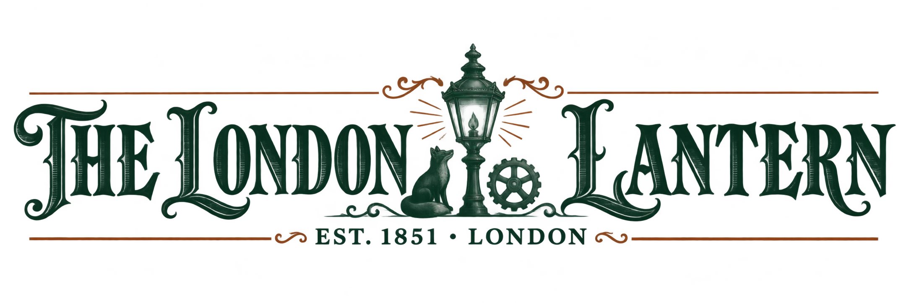
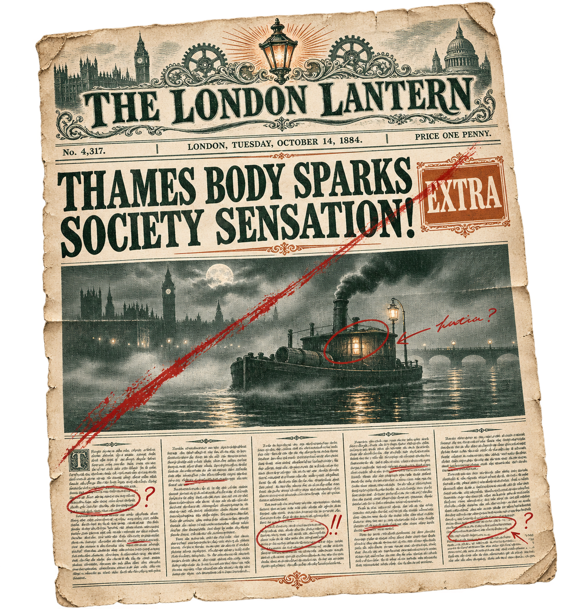
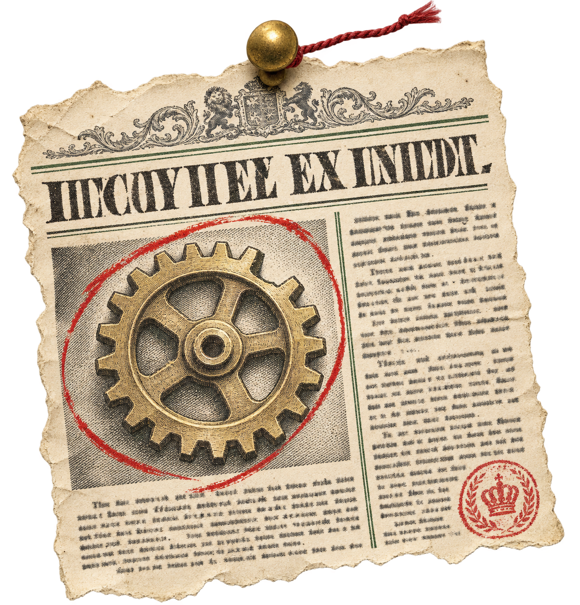

# 美術風格

**世人讀到的是報紙，Sherefox 寫下的是批註**。本作的美術以「報紙」為出發點：介面是一份維多利亞時代的大報版面，角色與場景是燈下的暖色厚塗插畫，論戰的書法大字與紅線則是偵探在報紙上落下的朱筆。報紙負責「世人以為的事實」，插畫負責「當下的現場」，批註負責「真相」。

## 一、核心概念

選擇報紙有三個理由：

1. **主題**：每案以報紙頭條開場、以次日頭版結算。報紙寫的是世人眼中的結果，未必是真相，正好把「自洽勝過真實」的主題畫出來。
2. **時代與蒸氣龐克**：報紙是維多利亞時代最主要的資訊載體，蒸氣印刷機則是這個世界的核心科技。
3. **劇情**：Ch.9 的偽證工廠就是一座印刷廠，破案關鍵是印刷機的缺字；Ch.8 發現倫敦變了，第一個線索就是報紙。報紙不只是風格，也是線索。

### 三層材質

| 層 | 代表 | 用在 | 質感 |
| --- | --- | --- | --- |
| 版面（報紙） | 世人的說法 | 所有 UI 框架、頭版、證物卡、圖鑑 | 米白新聞紙、深綠油墨、細欄線、鋼版畫插圖、半色調網點 |
| 燈下（插畫） | 現場 | 角色立繪、背景、CG | 暖色厚塗、煤氣燈與綠色銀行燈、雨夜窗景、霧 |
| 批註（筆觸） | 真相 | 書法大字、紅線、圈註、印章 | 朱墨毛筆、手繪紅圈、蓋印 |

- 版面永遠在最底層，批註永遠在最上層。
- 除了全幕大字演出，同一畫面的批註面積不超過 15%，讓朱紅保持稀有、有份量。
- 同一件證物在場景中是全彩插畫，收進檔案後就變成單色版畫剪報：玩家一眼就能分辨「現場」與「紀錄」。

## 二、色彩

主色取自形象網站 sherefox.com 的色票，再補上批註與劇情用色。

| 名稱 | 色碼 | 來源 | 用途 |
| --- | --- | --- | --- |
| 新聞紙 | #f3eedf | 官網 paper | 版面底色、對白框、證物卡 |
| 舊紙 | #e3d9c2 | 廢案 paper | 舊檔案、遺囑、十年前的卷宗 |
| 油墨綠 | #123a31 | 官網 green | 主要文字、欄線、版畫線條 |
| 深墨 | #092e28 | 官網 ink | 最深文字、夜間 UI 底 |
| 銅橙 | #a65432 | 官網 copper | 次要強調、按鈕外框、小標 |
| 朱批紅 | #b8322a | 新增 | 批註、論破、紅線、印章 |
| 燈火金 | #e0a050 | 官網主視覺 | 插畫光源、破竹疊層高光 |
| 霧夜藍 | #1f2c3d | 廢案城市層 | 夜景、戶外場景暗部 |
| 狼影紫 | #3b2a4a | Wolfhart 人設 | 銀牙會專屬色，Ch.8 起滲入版面 |

**色彩敘事**：前半的報紙乾淨，只有油墨綠與銅橙。Ch.8 起，報紙開始出現狼影紫的廣告框與浮水印，報頭的燈籠徽章旁多了一枚小小的狼頭，象徵倫敦被滲透。True End 的最後一版頭版，紫色全部退去。

**角色主色**：Sherefox 暖棕＋紅領結＋琥珀眼；Wolfhart 墨藍、暗紫與銀；亞瑟棕色＋黃銅義肢；巴斯克維爾海軍藍＋金扣；維多黑＋祖母綠。

## 三、字體

| 用途 | 中文 | 英文 | 備註 |
| --- | --- | --- | --- |
| 報頭 | — | 維多利亞雕版黑體字或裝飾襯線 | 只用於報頭與片頭 |
| 大標題 | 粗明體 | 粗襯線（官網標題字系） | 頭條、章名、對手主張節點 |
| 內文 | 明體 | Georgia 類襯線 | 對白、報導、證物說明 |
| 標籤 | 細黑體（中文不加字距） | 小型大寫、字距 0.2em | 小標、日期線、分類 |
| 數字 | 襯線舊式數字 | 同左 | 主導權、回合、日期 |
| 批註 | 行草書法 | 筆刷字英文副標 | 書法大字、紅圈旁註 |

繁體中文為主；英文作為報紙裝飾，用在報頭、小標與日期線，延續官網「SHEREFOX — PRIVATE DETECTIVE」那種銅色、字距拉開的小標。

## 四、版面語彙

報紙的每個元素都對應一個遊戲畫面或介面元件。遊戲內的報紙名為《倫敦提燈報》（The London Lantern）。

| 報紙元素 | 遊戲中的用法 |
| --- | --- |
| 報頭 | 標題畫面、章節開場；共三個版本：平常版、號外版、Ch.8 後的滲透版 |
| 頭版頭條 | 章節開場頭條、次日結算頭版 |
| 日期線 | 存檔欄位、章節時間戳（「1887 年 10 月・貝克街」） |
| 號外 | 論戰畫面的整體版型 |
| 欄線與分欄 | 所有面板的分隔；對白框就是一欄報導 |
| 小標（kicker） | 畫面類別標籤，銅橙色、字距拉開 |
| 鋼版畫插圖 | 證物卡、人物誌、圖鑑的插圖 |
| 剪報 | 線索板上的證物卡 |
| 分類廣告 | 圖鑑、人物誌、小型選項框 |
| 更正啟事 | 敗北後的負面頭條與重試畫面 |
| 鉛字排版 | 文字出現方式：活字逐字落下 |
| 印章 | 結案、扣押、權限取得、劇情證物入檔 |

## 五、各畫面美術

| 畫面 | 版面 | 插畫 | 批註 |
| --- | --- | --- | --- |
| 標題 | 《倫敦提燈報》報頭加頭版版型，選單排成目錄欄 | Sherefox 燈下書桌主視覺（承襲官網） | 報頭上一道朱筆勾 |
| 章節開場 | 頭條＋鋼版畫主圖（跨三欄）＋導言兩欄＋側欄刊出上一案結果；每章一張主圖：Ch.1 糕點鋪前的排隊人龍、Ch.2 櫗窗裡的報時鳥鐘、Ch.3 霧中駁船與警方提燈、Ch.4 升降梯斷裂的歌劇院舞台 | — | 無：這是世人的觀點，保持乾淨 |
| 日常與事件 | 下方對白框是一欄報導：細欄線、明體、說話者名用小標 | 全彩厚塗背景＋去背立繪 | 亞瑟旁白以手寫筆記字體出現 |
| 蒐證 | 場景插畫為主，左上角是小標與調查進度 | 全彩 | 調查點以鉛筆圈提示；取得證物時剪報飛進檔案夾 |
| 線索板 | 軟木板上釘滿剪報證物卡 | — | 實證是紅線、詭辯是鉛筆虛線、無效連結出現剪刀圖示 |
| 論戰 | 「號外」版型：對手主張以頭條字體排成節點，四個行動是鉛字塊，主導權是蒸氣壓力錶，預兆放在「小道消息」欄 | 對手與 Sherefox 立繪分居兩側 | 截斷是朱筆劃掉頭條，論破是書法大字寫在版面上，版面隨之撕裂 |
| 結算 | 次日頭版：世人版本的頭條 | 主圖是警督抓人的「新聞照」 | 「結案」或「更正」印章 |
| 圖鑑與人物誌 | 分類廣告版型、人物專欄 | 鋼版畫肖像 | 已取得的黃金線索蓋金色小印 |
| Ch.8 比對異樣 | 同一張頭版的前後對照 | 重用日常背景 | 找到的異樣用紅圈標出，狼影紫從這章開始滲入 |
| Ch.12 終局 | 全城蒸氣廣播開啟後，報紙停印，頭版變成一張空白版 | 發條塔頂夜景 | True End 的頭版改由 Sherefox 的批註寫成 |

## 六、插畫風格

- **角色立繪**：日系輕小說賽璐珞著色、加上柔和厚塗光影；去背全身站繪與表情差分；狐耳與尾巴有小動態。
- **背景**：承襲官網主視覺的燈下厚塗。室內暖（綠色銀行燈、煤氣燈），室外冷（霧夜藍、雨、燈暈）。蒸氣龐克元素藏在道具裡：銅管、壓力錶、齒輪，不搭大型機械奇觀。
- **版面內插圖**：鋼版畫與木刻風的單色線稿，只用油墨綠，和全彩插畫明確區分。
- **CG**：全彩厚塗，構圖按報紙頭版主圖的比例設計，可以直接轉成「頭版版本」當結算主圖。

## 七、動態與轉場

- **翻頁**：章節切換是報紙翻頁。
- **印刷滾筒**：大轉場（日常→事件、論戰開場）由蒸氣印刷機的滾筒刷過畫面，油墨從一側印上。
- **活字落下**：頭條與對手主張逐字落下定位，配鉛字碰撞聲。
- **油墨暈開**：立繪與插圖以墨暈方式淡入。
- **朱筆寫入**：所有批註（紅圈、劃線、書法大字）都以筆劃順序寫入，不直接出現。論破時版面從筆劃處撕開。
- 演出長度與跳過規則以系統規格的書法大字演出系統為準。

## 八、參考來源與取捨

| 來源 | 沿用 | 捨棄 |
| --- | --- | --- |
| 形象網站 sherefox.com | 色票（新聞紙、油墨綠、深墨、銅橙）、粗襯線標題、細欄線、銅色字距小標、編號卷宗、燈下主視覺、狐狸封蠟 | — |
| Midnight Grid 廢案 | 羊皮紙卷宗卡、紅色印章、紅線、目錄式選單、壓力錶、黃銅外框（降為點綴） | 以深藍霧夜為底的暗色介面、戰術棋盤、大面積黃銅機械、霧藍／青色發光 |
| 報紙出發（新增） | 報頭、號外、剪報、鋼版畫、活字、更正啟事、印刷滾筒轉場、狼影紫滲入 | — |

廢案的介面以「黃銅是操作、紙是閱讀」分工；本作改成「紙是世界、朱筆是真相」，黃銅只留在壓力錶與亞瑟的義肢等蒸氣龐克的點綴。

## 九、美術資源補充清單

以下為報紙風格專屬資源，立繪、背景、CG 與音樂清單見設計總覽「十一、美術與音樂方向」。

| 資源 | 數量 | 說明 |
| --- | --- | --- |
| 報頭 | 3 | 平常版、號外版、Ch.8 後滲透版（燈籠徽章旁多一枚狼頭） |
| 頭版版型 | 約 32 | 15 案各一版開場、一版結算，加三種結局、Ch.12 空白版 |
| 鋼版畫證物插圖 | 約 120 | 每件證物一張，與場景中的全彩版本配對 |
| 鋼版畫人物肖像 | 約 30 | 人物誌與圖鑑用 |
| 剪報框 | 5 | 一般、關鍵、劇情、黃金線索、次級替代證物 |
| 印章 | 8 | 結案、扣押、權限、入檔、更正、號外、機密、金色黃金線索印 |
| 批註筆刷組 | 1 套 | 紅圈、劃線、箭頭、問號、書法大字筆觸 |
| 紙張與網點材質 | 1 套 | 新聞紙、舊紙、半色調網點、油墨暈染 |

## 十、範例圖

以下為去背範例，作為美術方向參考。

**報頭：《倫敦提燈報》**。燈籠徽章兩側是狐狸與齒輪，Ch.8 後的滲透版會在燈籠旁加上一枚小狼頭。

**章節開場頭版樣張**。版面是世人的說法，朱筆劃線與紅圈是 Sherefox 的批註。圖中文字與日期為示意，正式版會換成繁中頭條與正確的 1887 年日期。

**剪報證物卡**。證物收進檔案後變成剪報，由圖釘與紅線釘在線索板上；紅圈表示關鍵證物。圖中文字為示意。

