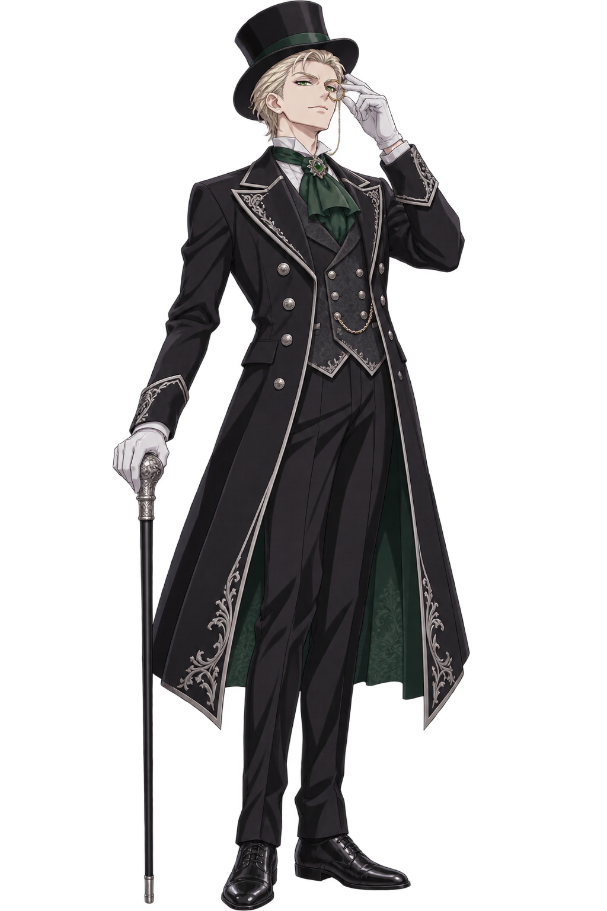

# Ch.5～Ch.8 案件設計

## Ch.5 巴斯克維爾警督的秘密休假日

一行定位：1887 年 12 月，日常・小，精簡循環（單一場景＋一場主論戰，無熱身），主導權 我方 120／對手 100，教學機制：觀察、應對感情牌。

### 開場頭條

《倫敦提燈報》：「蘇格蘭場名警督難得休假，行蹤成謎」。副標：東區聖瑪格麗特孤兒院連續三週遭竊建材。Sherefox 看到報紙，決定跟蹤警督當作惡作劇。

### 場景與登場人物

| 場景 | 可調查點 |
| --- | --- |
| 孤兒院後巷（唯一場景） | 封鎖告示、被撬開的建材木箱、屋頂梯子與新銅板、晾在欄杆上的披風、院長辦公室窗台的捐款收據、孩子們貼在門上的信 |

| 人物 | 身分 | 立場 |
| --- | --- | --- |
| 巴斯克維爾警督 | 休假中的犬耳族警督 | 庇護者：隱瞞自己在修屋頂、私下抓賊 |
| 瑪莎・霍爾 | 孤兒院年紀最大的孩子，陣亡霍爾中士之女 | 知情，替警督保密 |
| 比利 | 偷建材的少年，替廢料商跑腿 | 小偷，被警督私下追查 |
| 孤兒院院長 | 年邁修女 | 不知道修屋頂的人是誰 |

### 真相與事件時序

1. 一年前，警督的部下霍爾中士殉職，遺孤瑪莎被送進聖瑪格麗特孤兒院。
2. 孤兒院屋頂漏水，市政補助遲遲不來，警督自掏腰包買建材，利用休假日親手修繕。
3. 建材連續失竊。警督不願動用公權力（休假中、無授權），於是自寫告示封鎖後巷，打算私下抓賊。
4. 小偷是少年比利，被廢料商以債務逼著偷銅板。
5. 警督怕被同僚笑「鐵面警督當木匠」，也怕報紙把孤兒們寫成可憐蟲，因此對 Sherefox 百般掩飾。

### 證物表

| ID | 名稱 | 等級 | 標籤 | 鑑定 | 正確歸類理由 | 錯誤理由 |
| --- | --- | --- | --- | --- | --- | --- |
| E5\_01 | 沾滿孤兒院油漆的披風 | 關鍵 | 物理・地點・醜聞 | 無 | 油漆色號與孤兒院新漆的屋簷一致，證明他親手修屋頂 | 他在家粉刷房子／披風被小偷潑了漆 |
| E5\_02 | 後巷的手寫封鎖告示 | 一般 | 地點・人物 | 無 | 筆跡是警督本人，不是官方封鎖令 | 蘇格蘭場正式封鎖／院長所寫 |
| E5\_03 | 蘇格蘭場休假登記簿抄本 | 一般 | 時間・人物 | 無 | 當天他正式休假，封鎖沒有公務授權 | 他在執行秘密任務／登記簿抄錯 |
| E5\_04 | 被撬開的建材木箱 | 一般 | 物理・地點 | 機械 | 撬痕來自小號撬棍，小偷是少年 | 警督自己撬開／被風吹壞 |
| E5\_05 | 屋頂上的新銅板與鉚釘 | 一般 | 物理 | 機械 | 鉚法是軍隊工兵式，與警督的工兵隊經歷吻合 | 專業工匠所做／原本就有的舊板 |
| E5\_06 | 霍爾中士的陣亡通知書 | 一般 | 人物・時間 | 無 | 瑪莎是霍爾的遺孤，說明警督的動機 | 警督要收養瑪莎／通知書是偽造的 |
| E5\_07 | 孩子們貼在門上的感謝信 | 一般 | 人物・醜聞 | 無 | 孩子們早就知道是他在修，隱瞞沒有意義（動機類） | 寫給院長的信／比利寫的道歉信 |
| E5\_08 | 署名「W」的匿名捐款收據 | 劇情 | 人物 | 無 | — | — |

E5\_08 是 Wolfhart 的痕跡：一筆足以修好整個屋頂的捐款，比警督的建材早一週入帳，院長還沒拆封。一週目只會被當成善心人士，二週目會標上狼頭徽記。

### 主論戰

對手：巴斯克維爾警督（庇護者型）。同時出招制：每回合雙方同時鎖定行動，玩家依上一回合的預兆判讀警督的下一手。本章教學重點是「觀察」與「悲情牌」。

#### 對手行為表

| 項目 | 內容 |
| --- | --- |
| 基本傾向 | 補強 50%、主張 25%、設陷 20%、猛攻 5%；悲情牌是補強的變體，只在尾聲出現 |
| 適用行為規則 | 規則 1（節點被移除→傾向補強）、規則 2（上回合詭辯→傾向設陷）、規則 3（主導權首次低於 50%→必定猛攻）、規則 4（補強成功→傾向主張）、規則 5（同招連出兩次→第三次換招），五條全部適用 |
| 預兆清晰度 | 明示 30%、模糊 70%、偽裝 0%；觀察被攻擊打中後的下一回合、以及規則 3（必定猛攻）時為明示；其他規則適用時，模糊預兆把規則指向的行動標為「較可能」 |

| 對手行動 | 小動作 | 預兆台詞範例 |
| --- | --- | --- |
| 主張 | 挺胸、手指向前 | 「本官今天只是來散步！」 |
| 猛攻 | 拍膝、耳朵豎直、尾巴炸毛 | 「本官在蘇格蘭場二十年——」 |
| 補強 | 雙手抱胸、尾巴繃緊、耳朵微垂 | 「本官的私事……不，本官沒有私事！」 |
| 設陷 | 摸鬍子、眯起一隻眼 | 「哼，妳說吧，本官聽著。」 |
| 悲情（補強變體） | 摘帽按在胸前、耳朵完全垂下 | 「霍爾的女兒承受得起嗎？」 |

| 節點 | 主張 | 破解證物 |
| --- | --- | --- |
| 主張一 | 「我只是來附近散步」 | E5\_03 |
| 主張二 | 「後巷封鎖是公務需要」 | E5\_02 |
| 主張三 | 「屋頂是院方請工匠修的」 | E5\_05 |
| 脆弱節點（觀察後新增） | 「我是在追查建材竊案」 | E5\_04 |
| 補強回復節點 | 「這披風是舊的」 | E5\_01（醜聞類） |

#### 推薦路線

| 回合 | 預兆（台詞／動作／亮起節點／清晰度） | 玩家判讀 | 玩家行動 | 對手行動 | 結果 | 狀態（破竹：回合開始→結束） |
| --- | --- | --- | --- | --- | --- | --- |
| 1 | 「本官今天只是來散步！」／挺胸，但尾巴繃緊／主張一／模糊（主張或補強） | 尾巴繃緊像在守，庇護者以補強為主，先觀察換情報（讀錯：他其實要開口） | 觀察 | 主張 | 被主張打中，觀察減半：(50＋4×3)×0.5＝31（我方 120→89）；警督說溜嘴提到竊案；下一回合預兆明示 | 破竹 0（讀錯，維持 0） |
| 2 | 「本官的私事……不，本官沒有私事！」／雙手抱胸、尾巴繃緊／主張三／明示（補強） | 觀察換來明示：補強；補強怕詭辯 | 詭辯：E5\_04→E5\_02⇢E5\_07 | 補強 | 詭辯壓過補強，全額 14×2.3＝32.2（警督 100→67.8）；警督 +1 節點（已在上限 3），被打中不回復；亞瑟皺眉 | 破竹 0→1 |
| 3 | 「哼，妳那紙接紙的把戲，本官看得一清二楚。」／摸鬍子、眯眼／主張二／明示（規則 2：設陷） | 明示設陷，用實證破陷阱 | 實證連鎖：E5\_02→E5\_04→E5\_01→E5\_05 | 設陷 | 陷阱落空，全額 14×2.5×1.1（破竹 1）＝38.5（67.8→29.3）；醜聞類 E5\_01 命中觸發動搖；移除主張二、主張三（剩 1 個）；警督下回合不能補強；首次低於 50%，並降到 ≤30%，困獸觸發 | 破竹 1→2；困獸觸發（警督降到 ≤30%） |
| 4 | 「本官在蘇格蘭場二十年——」／拍膝、耳朵豎直／「這披風是舊的」／明示（規則 3：首次低於 50%，必定猛攻） | 必定猛攻，又是動搖第 2 回合：反駁截斷並論破 | 反駁論破：「這披風是舊的」＋E5\_04→E5\_01→E5\_05 | 猛攻 | 截斷：我方不受傷（擋下 (50＋4×2)×1.25×1.25（困獸）＝90.6）；反擊 30×1.2（破竹 2）＝36（不乘動搖；29.3→0 以下），論破再扣 75，鎖在 1，清空節點；困獸隨論破結束 | 破竹 2→3；困獸生效（猛攻 ×1.25），論破時結束 |
| 5 | 「霍爾的女兒承受得起嗎？」／摘帽按胸、耳朵垂下／悲情牌／明示 | 悲情牌是補強變體，物理證物會被反彈，要出動機類證物 | 實證連鎖：E5\_07→E5\_06 | 悲情（尾聲反撲） | 尾聲劇本回合答對，收尾勝利；我方剩 89（74%） | 破竹 3（尾聲劇本回合） |

#### 常見錯誤回合

第 3 回合在明示設陷下沿用上回合的詭辯（E5\_04→E5\_02⇢E5\_07）：中陷阱，本回合傷害作廢，我方受 25（89→64）、該條虛線被打斷、惡名 +1，破竹歸零（1→0）；沒有事先發動援護則觸發失守，第 4 回合不能反駁。警督停在 67.8，沒被削血也沒動搖，第 4 回合仍可補強，論破至少延後 2 回合。鎖定前亞瑟會提示：「他在摸鬍子。上次他摸鬍子，是在等妳犯錯。」

### 結算

- **勝利頭條**：「警督休假日勇擒建材竊賊」。警督照例搶功，但私下把比利交給孤兒院而不是送警局。他把懷錶塞給 Sherefox：「哪天我被冤枉了，妳拿著它來找我。」取得劇情證物【警督的私人懷錶信物】，警督信任度 +1。
- **敗北頭條**：「狐耳偵探跟蹤警督，休假日鬧劇一場」。警督信任度 −1，**不取得**【警督的私人懷錶信物】，Ch.9-1 失去「證物保管紀錄」隱藏選項。
- **黃金線索與伏筆**：本章不產出黃金線索。E5\_01 推理正確計入 True End 條件。E5\_08 的「W」捐款留待二週目回看。

### 數值卡

共用規則（Ch.5～8 適用；同時出招制，以數值總表為準）：我方中期主導權 120。鏈傷害 = 14 ×（1 ＋ 0.5 × 實證連結數 ＋ 0.8 × 詭辯連結數）× 動搖倍率（1.5／1.0），單張證物 14；對手主張傷害 = 50 ＋ 4 × 回合開始時場上節點數（Ch.7 B 段基礎值 36），猛攻 = 主張 × 1.25，第 15 回合起 +5。對決結果：實證或詭辯對主張／猛攻為交鋒（鏈傷害 ×0.5，我方全額受傷）；實證對補強鏈傷害 ×0.5，對設陷全額且對手下一回合不能補強；詭辯對補強全額，對設陷傷害作廢、我方受 25、打斷該條虛線、惡名 +1（若玩家在這回合鎖定前已事先發動援護、押注設陷，可擋下，每場 1 次，Ch.7 每段 1 次）；反駁對主張／猛攻截斷（我方不受傷、移除亮起節點、對手受 30，截斷猛攻使對手動搖），對補強或設陷空過；觀察對主張／猛攻受傷 ×0.5 並讓下一回合預兆明示，對補強或設陷新增 1 個脆弱節點（下一次攻擊命中時 +10 後移除），對設陷時對手下一回合必定攻擊。補強一律讓對手 +1 節點，沒有被攻擊打中時再回復最大主導權 10%。節點：每回合開始對手補回 1 個（不超過上限），第 1 回合從上限開始；實證連鎖含亮起節點的破解證物時移除節點（4 張以上最多 2 個）。動搖：反駁截斷猛攻、醜聞類證物以實證連鎖命中（遇補強傷害減半仍觸發）、或對手主導權 ≤ 60% 時的 4 張以上實證連鎖；持續 2 回合，觸發回合算第 1 回合，只有下一回合的攻擊 ×1.5，論破也必須在該回合打出。論破：以 3 張無弱點連鎖，用實證連鎖（無視補強減傷與設陷）或反駁（對手出攻擊才成立；對手守則落空、動搖結束）打出，先算該鏈傷害，再扣對手最大主導權 75%，不足 1 鎖在 1，清空節點，對手維持動搖。尾聲：1 回合劇本回合，覆蓋對手 AI，答錯一次扣 60；回合用完仍未收尾則論破作廢，對手回到最大主導權 25%，剩餘部分論破門檻 +1 張。同一場論戰中證物可重複使用。

| 項目 | 數值 |
| --- | --- |
| 主導權 | 我方 120／警督 100（破防線 60） |
| 主張鏈節點 | 上限 3（主張一～三），第 1 回合從上限開始，每回合開始補回 1 個；「這披風是舊的」是節點池的補位主張；觀察對補強或設陷時新增脆弱節點「我是在追查建材竊案」（下一次攻擊命中 +10 後移除）；尾聲為劇本回合（悲情牌）。警督主張傷害 = 50 ＋ 4 × 回合開始時節點數：3 個 62、2 個 58、1 個 54；猛攻 ×1.25（3 個 77.5、2 個 72.5） |
| 觀察 | 本章觀察特別有效：對主張／猛攻受傷 ×0.5，下一回合預兆明示；對補強新增脆弱節點，警督 +1 節點並回復 10；對設陷新增脆弱節點，警督下一回合必定攻擊 |
| 回合推演 | 第 1 回合觀察（預兆模糊，讀成補強），警督出主張：觀察受傷減半 (50 ＋ 4 × 3) × 0.5 = 31（我方 120→89），下一回合預兆明示；第 2 回合明示補強，詭辯 E5\_04→E5\_02⇢E5\_07 = 14 × 2.3 = 32.2 全額（100→67.8），警督 +1 節點（已在上限 3）；第 3 回合明示設陷（規則 2），實證 E5\_02→E5\_04→E5\_01→E5\_05 = 14 × 2.5 × 1.1（破竹 1）= 38.5 全額（67.8→29.3），E5\_01 醜聞命中觸發動搖，移除主張二、主張三，警督下回合不能補強，且首次低於 50%、降到 ≤30% 觸發困獸；第 4 回合規則 3 必定猛攻（明示），反駁截斷論破：我方不受傷（擋下困獸猛攻 (50 ＋ 4 × 2) × 1.25 × 1.25 = 90.6），反擊 30 × 1.2（破竹 2）= 36（不乘動搖；29.3→0 以下），論破再扣 75，鎖在 1，清空節點進入尾聲；第 5 回合尾聲（劇本回合）悲情牌，以 E5\_07→E5\_06 收尾勝利（答錯一次扣 60） |
| 預期回合 | 5 回合（觀察 1、詭辯 1、連鎖 1、論破 1、尾聲 1）；推薦路線結束時我方剩 89（74%），唯一一次受傷是第 1 回合觀察被主張打中；破竹第 4 回合結束時到 3 層，第 3 回合困獸觸發（第 4 回合生效、隨論破結束），全程無失守 |
| 漏撿代價 | 每漏 1 件證物，警督節點上限 +1（主張傷害 +4）；多出的是一般節點，照常可被反駁或含破解證物的實證連鎖移除 |
| 熱身／權限 | 無 |
| 勝利 | 信任度 +1；取得【警督的私人懷錶信物】 |
| 敗北 | 信任度 −1；不取得信物 |
| 惡名值 | 每被拆穿 1 條詭辯 +1；章末 ≥3 時刊出負面頭條，信任度再 −1 |

同時出招制數值（已依數值總表校正）：推薦路線 5 回合，我方 120 → 89（74%），第 1 回合讀錯、觀察吃下減半的主張 31；常見錯誤回合（第 3 回合再出詭辯）再受 25 並延後論破 2 回合；狐耳直覺每場 2 次，推薦路線沒有動用。

## Ch.6 約克郡礦坑的幽靈列車

一行定位：1887 年 12 月，外地・正式，完整循環（以權限爭取取代熱身），主導權 我方 120／對手 150，教學機制：沒有警督支援，靠心理戰與鑑定自行爭取現場權限。

### 開場頭條

《約克郡郵報》：「無人列車深夜狂奔，撞毀北方礦業金庫——礦工稱是『幽靈列車』」。Sherefox 與亞瑟原本只是來替樓下「報時鳥」鐘錶店老闆送貨，被礦場主當場委託。

### 場景與登場人物

| 場景 | 可調查點 |
| --- | --- |
| 礦場車站 | 撞毀的金庫、列車殘骸、鐵軌上的煤灰腳印 |
| 調度室 | 電報機、電報紀錄簿、密碼本保險櫃 |
| 列車駕駛室 | 巡航裝置殘骸、鍋爐壓力計 |
| 礦工宿舍 | 礦工證詞、總工程師的工作手套 |
| 礦坑支線隧道 | 第二輛失控列車停下的位置、制動閥 |

| 人物 | 身分 | 立場 |
| --- | --- | --- |
| 艾德格・索恩 | 北方礦業總工程師 | 犯人：監守自盜 |
| 哈洛德・溫斯洛 | 礦場主 | 委託人，急著保密 |
| 喬・派克 | 夜班調度員 | 被冤枉的代罪羔羊 |
| 葛林治安官 | 地方治安官 | 排斥倫敦偵探，掌握現場出入 |

### 真相與事件時序

1. 索恩替一家倫敦空殼公司「北岸信託」做事，目標是金庫裡的可轉讓空白債券。
2. 他在運煤列車上私裝蒸汽自動巡航裝置，讓列車無人駕駛也能保持定速。
3. 深夜他用密碼本竄改調度電報碼，讓全線顯示「淨空」，列車精準撞進金庫車廂。
4. 混亂中他取走空白債券，現場只留下散落的金幣，讓人以為什麼都沒少。
5. 調查中，索恩再放出第二輛失控列車，想在支線隧道裡滅口 Sherefox 與亞瑟。
6. 列車在隧道口被 Wolfhart 的人拉下緊急制動閥停住，玩家只瞥見一個穿深色大衣的身影消失在樹林裡。現場只留下一枚印有狼頭徽（銀牙會徽記）的鉛封，這是 Wolfhart 第二次暗中保下 Sherefox。

### 證物表

| ID | 名稱 | 等級 | 標籤 | 鑑定 | 正確歸類理由 | 錯誤理由 |
| --- | --- | --- | --- | --- | --- | --- |
| E6\_01 | 被竄改的鐵路調度電報碼 | 關鍵 | 時間・地點 | 機械 | 電報碼被改成「全線淨空」，只有握有密碼本的總工程師能發 | 調度員操作失誤／電報機故障 |
| E6\_02 | 蒸汽自動巡航裝置殘骸 | 一般 | 物理 | 機械 | 裝置是手工改裝而非原廠品，需要工程師級技術 | 原廠標配零件／礦工的玩具 |
| E6\_03 | 鍋爐壓力紀錄 | 一般 | 時間・物理 | 機械 | 無人駕駛下壓力仍恆定，證明有自動調壓 | 壓力計壞了／有人躲在駕駛室 |
| E6\_04 | 金庫門的撞擊凹痕 | 一般 | 物理・地點 | 機械 | 撞擊角度顯示列車被精準對準金庫 | 隨機出軌／金庫本來就破舊 |
| E6\_05 | 空白債券存根 | 一般 | 醜聞・人物 | 無 | 被盜的是可轉讓空白債券，不是金幣 | 礦場主的私人帳本／作廢的舊債券 |
| E6\_06 | 總工程師的工作手套 | 一般 | 人物・物理 | 醫療 | 手套內的燙傷皮屑與索恩手上的新傷吻合 | 調度員的手套／舊傷留下的皮屑 |
| E6\_07 | 調度員的酒館帳單 | 一般 | 時間・人物 | 無 | 事發時派克在酒館，有不在場證明 | 帳單是偽造的／他喝醉了才發錯電報 |
| E6\_08 | 礦工宿舍的證詞筆記 | 一般 | 人物・時間 | 無 | 礦工夜裡聽到兩次汽笛，第一次是測試 | 幽靈列車的證明／礦工在說謊 |
| E6\_09 | 印有狼頭徽的制動閥鉛封 | 劇情 | 地點 | 無 | — | — |

E6\_01 推理正確時，系統默默收進 **G-03【北方礦業空白債券流向單】**：債券兌現後流向倫敦空殼公司「北岸信託」。

### 權限爭取

| 關卡 | 阻擋者 | 過關方式 | 失敗代價 |
| --- | --- | --- | --- |
| 一：進入撞毀現場 | 葛林治安官 | 出示亞瑟的醫護兵退伍證，並點出治安官靴上沾著金庫車廂的煤灰（他也偷偷進去過） | E6\_04 進入對手手牌 |
| 二：調度室紀錄 | 調度員派克 | 心理戰選「沉默等待」，讓他自己說出怕被開除 | E6\_01 只能事後從殘頁取得，需額外鑑定一次 |
| 三：金庫殘骸 | 礦場主溫斯洛 | 承諾「不讓倫敦報紙報導債券失竊」 | E6\_05 進入對手手牌；惡名值 +1 |

### 主論戰

對手：艾德格・索恩（犯人型）。犯人型以攻擊為主、被逼急就猛攻，本章教學重點是「模糊預兆的深入判讀、無警官支援」。

#### 對手行為表

| 項目 | 內容 |
| --- | --- |
| 基本傾向 | 主張 45%、猛攻 15%、補強 20%、設陷 20% |
| 適用行為規則 | 規則 1（節點被移除→傾向補強）、規則 2（上回合詭辯→傾向設陷）、規則 3（主導權首次低於 50%→必定猛攻）、規則 4（補強成功→傾向主張）、規則 5（同招連出兩次→第三次換招），五條全部適用；規則 3 是他最常露出的破綻 |
| 預兆清晰度 | 明示 30%、模糊 70%、偽裝 0%；規則 3（必定猛攻）時為明示；其他規則適用時，模糊預兆把規則指向的行動標為「較可能」 |

| 對手行動 | 小動作 | 預兆台詞範例 |
| --- | --- | --- |
| 主張 | 用纏著繃帶的手指向桌上的列車模型 | 「老舊的列車自己滑出去，就這麼簡單。」 |
| 猛攻 | 繃帶手重拍桌面、聲音拔高 | 「我是工程師！我比任何人都懂這輛車！」 |
| 補強 | 翻開工程手冊、低頭擦汗 | 「……讓我查一下調度紀錄。」 |
| 設陷 | 把繃帶手藏到背後、嘴角上揚 | 「說吧，偵探小姐，把妳那條虛線再說一次。」 |
| 玉石俱焚（尾聲） | 扯掉繃帶、眼神渙散 | 「調度員才是共犯！」 |

| 節點 | 主張 | 破解證物 |
| --- | --- | --- |
| 主張一 | 「列車是自行滑動的意外」 | E6\_03 |
| 主張二 | 「調度員發錯了電報」 | E6\_07 |
| 主張三 | 「金庫裡只少了幾枚金幣」 | E6\_05（醜聞類） |
| 階段二（論破後） | 「裝置是礦場主逼我裝的」 | E6\_06 |

#### 推薦路線

| 回合 | 預兆（台詞／動作／亮起節點／清晰度） | 玩家判讀 | 玩家行動 | 對手行動 | 結果 | 狀態（破竹：回合開始→結束） |
| --- | --- | --- | --- | --- | --- | --- |
| 1 | 「老舊的列車自己滑出去，就這麼簡單。」／繃帶手指向列車模型／主張一／模糊（主張或猛攻） | 兩種可能都是攻擊，犯人型適合反駁 | 反駁：主張一＋E6\_03 | 主張 | 截斷：不受傷，移除主張一，反擊 30（150→120） | 破竹 0→1（第 1 次截斷） |
| 2 | 「……讓我查一下調度紀錄。」／翻開手冊、低頭擦汗，繃帶手卻悄悄縮到背後／主張二／模糊（補強或設陷；規則 1 標示補強較可能） | 手冊與擦汗指向補強，補強怕詭辯（讀錯：漏看繃帶手） | 詭辯：E6\_02→E6\_04→E6\_03⇢E6\_08 | 設陷 | 中陷阱：傷害作廢，我方受 25（120→95），虛線 E6\_03⇢E6\_08 被打斷，惡名 +1；沒有事先發動援護，觸發失守；亞瑟皺眉 | 破竹 1→0（讀錯）；失守（沒有事先發動援護，下回合不能反駁） |
| 3 | 「說吧，偵探小姐，把妳那條虛線再說一次。」／繃帶手藏到背後、嘴角上揚／主張三／明示（規則 2：設陷） | 明示設陷，用實證破陷阱 | 實證連鎖：E6\_07→E6\_06→E6\_05 | 設陷 | 陷阱落空，全額 14×2.0＝28（120→92）；醜聞類 E6\_05 觸發動搖；移除主張三；索恩下回合不能補強 | 失守中（不能反駁）；破竹 0→1 |
| 4 | 「我是工程師！我比任何人都懂這輛車！」／繃帶手重拍桌面／主張一（重新陳述）／模糊（主張或猛攻） | 不能補強、設陷已連出兩次必定換招，一定是攻擊；動搖第 2 回合，用反駁論破 | 反駁論破：主張一＋E6\_03→E6\_01→E6\_07 | 猛攻 | 截斷猛攻：不受傷（擋下 (50＋4×3)×1.25＝77.5），反擊 30×1.1（破竹 1）＝33（不乘動搖；92→59），論破再扣 112.5，鎖在 1；索恩換第二套說詞 | 破竹 1→2；第 2 次截斷與論破同回合，困獸不觸發，也不占用該條件 |
| 5 | 「調度員才是共犯！」／扯掉繃帶／玉石俱焚／明示 | 犯人的反撲要用反駁＋2 張無弱點實證 | 反駁：E6\_07→E6\_06 | 玉石俱焚 | 尾聲劇本回合答對，截斷收尾勝利；我方剩 95（79%） | 破竹 2（尾聲劇本回合） |

#### 常見錯誤回合

第 2 回合沿用第 1 回合的反駁，以為他還會開口：預兆標示補強較可能，他一補強，反駁就空過、破竹歸零（1→0），索恩 +1 節點（主張鏈維持 3 個，下回合主張 62）並回復最大主導權 10%（120→135）；規則 4 觸發，下一手傾向主張。玩家白白浪費一回合，還失去用詭辯削血的最佳時機。鎖定前亞瑟會提示：「他在翻手冊，不是在找話說，是在找退路。」

### 結算

- **勝利頭條**：「葛林治安官破獲幽靈列車案」。功勞被地方治安官拿走。索恩被押往倫敦受審。
- **敗北頭條**：「倫敦偵探攪局，礦場事故草草結案」。債券存根被礦場主收回，G-03 無法取得；派克被解僱；惡名值 +1。
- **黃金線索與伏筆**：取得 G-03（流向 Ch.9-2、Ch.9-4、Ch.12）。E6\_09 鉛封是「三件救人痕跡」之二。北岸信託在 Ch.9-2 會替索恩支付保釋金。

### 數值卡

| 項目 | 數值 |
| --- | --- |
| 主導權 | 我方 120／索恩 150（破防線 90） |
| 主張鏈節點 | 上限 3（主張一～三），第 1 回合從上限開始，每回合開始補回 1 個；論破後階段二「裝置是礦場主逼我裝的」＋尾聲反撲（劇本回合）。索恩主張傷害 = 50 ＋ 4 × 回合開始時節點數：3 個 62、2 個 58、1 個 54；猛攻 ×1.25（3 個 77.5） |
| 觀察 | 對犯人型效果有限：對主張／猛攻受傷 ×0.5、下一回合預兆明示；對補強新增脆弱節點，但索恩 +1 節點並回復 15 |
| 回合推演 | 第 1 回合反駁截斷主張：反擊 30（150→120），移除主張一；第 2 回合預兆模糊（規則 1 標示補強較可能），詭辯 E6\_02→E6\_04→E6\_03⇢E6\_08 撞上設陷：傷害作廢，我方受 25（120→95），虛線被打斷，惡名 +1，沒有事先發動援護，觸發失守（第 3 回合不能反駁）；第 3 回合明示設陷（規則 2），實證 E6\_07→E6\_06→E6\_05 = 14 × 2.0 = 28 全額（120→92），E6\_05 醜聞命中觸發動搖，移除主張三，索恩下回合不能補強；第 4 回合不能補強、設陷已連出兩次必定換招，反駁截斷猛攻論破：我方不受傷，反擊 30 × 1.1（破竹 1）= 33（不乘動搖；92→59），論破再扣 112.5，鎖在 1，清空節點進入尾聲（第 2 次截斷與論破同回合，困獸不觸發），索恩換第二套說詞；第 5 回合尾聲（劇本回合）玉石俱焚，反駁 E6\_07→E6\_06 收尾（答錯一次扣 60） |
| 預期回合 | 5 回合；推薦路線結束時我方剩 95（79%），唯一一次受傷是第 2 回合詭辯撞上設陷（破竹歸零、觸發失守）；破竹第 4 回合結束時到 2 層，第 4 回合第 2 次截斷與論破同回合，困獸不觸發 |
| 漏撿代價 | 每漏 1 件證物，索恩節點上限 +1（主張傷害 +4）；漏 E6\_01 則無法論破，只能以詭辯連鎖磨血，G-03 不取得 |
| 權限關卡一 | 成功：已調查「鐵軌上的煤灰腳印」，並在 4 個對話選項中選中「醫護兵退伍證」與「靴上煤灰」，允許錯 1 次。失敗：錯 2 次，E6\_04 進入對手手牌 |
| 權限關卡二 | 成功：連續 2 次選「沉默等待」。失敗：任一次選「逼問」，E6\_01 需額外鑑定才可取得（多花 1 次鑑定機會） |
| 權限關卡三 | 成功：接受保密承諾，無代價。失敗：拒絕或嘲諷礦場主，E6\_05 進入對手手牌，惡名值 +1 |
| 勝利 | 信任度 ±0（警督不在場）；取得 G-03 與 E6\_09 |
| 敗北 | 信任度 −1（負面新聞傳回倫敦）；G-03 不取得 |
| 惡名值 | 每被拆穿 1 條詭辯 +1；章末 ≥3 時刊出負面頭條，信任度再 −1 |

同時出招制數值（已依數值總表校正）：推薦路線 5 回合，我方 120 → 95（79%），第 2 回合讀錯、詭辯撞上設陷受 25；常見錯誤（對補強出反駁）使索恩 +1 節點並回復 15、多拖 1 回合；第 4 回合若誤判成補強而出詭辯，交鋒會讓我方受猛攻 (50＋4×3)×1.25＝77.5，並觸發失守（下一回合不能反駁、破竹歸零）。

## Ch.7 高地莊園的暴風雪遺囑

一行定位：1888 年 1 月，外地・正式，完整循環（以權限爭取取代熱身），主導權 我方 120／對手 170（分兩條：伯爵夫人 80、維多 90，我方主導權延續不回復），教學機制：對手握有場外證物、尾聲反撲與二連論破初體驗。

### 開場頭條

《蘇格蘭人報》：「暴風雪封山，高地鐵路停駛三日」。約克郡案結束後，Sherefox 與亞瑟應麥格雷戈伯爵之邀北上高地作客，回程途中受困莊園；當夜老伯爵猝死，新遺囑不翼而飛。被長子請來處理繼承的維多・克勞也在莊園裡。

### 場景與登場人物

| 場景 | 可調查點 |
| --- | --- |
| 書房 | 壁爐灰燼、伯爵倒地處、停止的懷錶、空的遺囑盒 |
| 大廳 | 管家證詞、律師來信 |
| 伯爵臥室 | 藥櫃、處方（維多封鎖中） |
| 溫室 | 除蟲藥罐、購藥收據 |

| 人物 | 身分 | 立場 |
| --- | --- | --- |
| 麥格雷戈伯爵 | 死者，貴族院議員 | — |
| 艾蓮諾伯爵夫人 | 伯爵續弦，長子生母 | 庇護者：燒毀遺囑保護兒子 |
| 羅伯特 | 長子，下屆貴族院席位繼承人 | 被懷疑的人 |
| 管家鄧肯 | 服侍三十年的老管家 | 證人 |
| 維多・克勞 | 對手偵探 | 咬定長子毒殺 |

### 真相與事件時序

1. 兩週前伯爵修改遺囑，在附件裡附上「貴族院秘密政治獻金名冊」，打算死後公開，向政敵贖罪。
2. 當晚 1:00 前，長子與伯爵在書房激烈爭吵，之後回房。
3. 2:10，伯爵獨自在書房心臟病發，倒地時懷錶撞停。
4. 伯爵夫人發現遺體，知道附件一旦公開，兒子的政治前途就毀了，於是把遺囑丟進壁爐。
5. 附件用的是防火金箔紙，沒有燒盡，殘片埋在灰燼裡。
6. 名冊中有一頁早已被人精準裁走。那是 Wolfhart 的痕跡：她比所有人更早拿到需要的那一頁。

### 證物表

| ID | 名稱 | 等級 | 標籤 | 鑑定 | 正確歸類理由 | 錯誤理由 |
| --- | --- | --- | --- | --- | --- | --- |
| E7\_01 | 壁爐灰燼中的防火金箔紙 | 關鍵 | 物理・醜聞 | 機械 | 這是遺囑附件專用的防火紙，證明遺囑被焚燬，附件記載政治獻金 | 壁爐裝飾殘片／伯爵燒掉的舊情書 |
| E7\_02 | 伯爵遺體驗屍結果 | 一般 | 時間・物理 | 醫療 | 死於心臟衰竭，胃中無毒 | 慢性砒霜中毒／被人勒斃 |
| E7\_03 | 停在 2:10 的伯爵懷錶 | 一般 | 時間 | 機械 | 倒地時撞停，死亡時間是 2:10 | 懷錶本來就壞了／有人事後撥動 |
| E7\_04 | 長子購買砒霜的收據 | 一般 | 人物・醜聞 | 無 | 用於溫室除蟲，用量與溫室帳一致 | 毒殺的準備／替伯爵買的藥 |
| E7\_05 | 管家鄧肯的證詞 | 一般 | 時間・人物 | 無 | 爭吵在 1:00 結束，長子回房後沒再出來 | 管家包庇長子／管家記錯時間 |
| E7\_06 | 伯爵夫人袖口的灰燼 | 一般 | 人物・物理 | 無 | 她碰過壁爐 | 她剛添過柴火／灰燼是長子沾上的 |
| E7\_07 | 律師的遺囑修改通知信 | 一般 | 時間・醜聞 | 無 | 伯爵兩週前改過遺囑，律師手上有副本（動機類） | 律師催討帳款／舊遺囑的確認信 |
| E7\_08 | 家庭醫生的心臟藥處方 | 一般 | 人物・物理 | 醫療 | 伯爵長期服用心臟藥，本來就有猝死風險 | 長子調包的毒藥／夫人的安眠藥 |
| E7\_09 | 名冊中被精準裁去的一頁 | 劇情 | 醜聞 | 無 | — | — |

E7\_01 推理正確時，系統默默收進 **G-04【貴族院秘密政治獻金名冊】**。E7\_08 是維多的場外證物，一開始玩家拿不到（見下方尾聲）。

### 權限爭取

| 關卡 | 阻擋者 | 過關方式 | 失敗代價 |
| --- | --- | --- | --- |
| 一：檢查遺體 | 管家鄧肯 | 依蘇格蘭貴族禮儀致哀，並由亞瑟以前戰地醫護兵的身分請求檢查遺體 | E7\_02 延後到論戰中才由維多公開，對手 +1 節點 |
| 二：調查壁爐 | 伯爵夫人 | 等夫人離開書房安撫長子時再行動（選對時機） | E7\_01 進入維多手牌，G-04 無法取得 |
| 三：進入臥室 | 維多・克勞 | 交換情報：交出一件一般證物換取進入 | 被交出的證物同時加入維多手牌 |

### 主論戰

兩段式：A 段伯爵夫人（庇護者），B 段維多（鏡像）。我方主導權兩段延續不回復，援護每段限 1 次。本章教學重點是「鏡像對手要換招」與「用小動作識破偽裝預兆」。

#### 對手行為表

| 項目 | A 段：伯爵夫人 | B 段：維多 |
| --- | --- | --- |
| 基本傾向 | 補強 50%、主張 25%、設陷 20%、猛攻 5%；悲情牌是補強變體 | 鏡像：約 80% 出玩家上一手的剋招（上回合實證→補強、詭辯→設陷、反駁→補強、觀察→主張）；其餘依主張 30%、猛攻 10%、補強 30%、設陷 30% |
| 適用行為規則 | 規則 1、2、4、5；規則 3 只在未打出動搖時觸發 | 規則 2、3、5 優先於鏡像；規則 1、4 不適用（維多不會因丟節點而退守） |
| 預兆清晰度 | 明示 30%、模糊 70%、偽裝 0% | 明示 30%、模糊 60%、偽裝 10%；偽裝必定伴隨「單片眼鏡反光」，且台詞與動作對不上 |

| 對手行動 | 伯爵夫人的小動作 | 維多的小動作 |
| --- | --- | --- |
| 主張 | 雙手交握、垂眼後直視 | 手杖指向對方 |
| 猛攻 | 起身、合上扇子敲掌心 | 手杖重敲地板、聲音拔高 |
| 補強 | 用手帕按眼角 | 雙手拄手杖、閉眼 |
| 設陷 | 微笑、輕撫袖口灰燼處 | 慢慢摘下白手套 |
| 特殊 | 悲情牌：手帕落地、聲音發抖 | 第二層真相：台詞像補強，手杖尖端卻抬起，單片眼鏡反光 |

| 段 | 節點 | 主張 | 破解證物 |
| --- | --- | --- | --- |
| A | 主張一 | 「遺囑從未修改過」 | E7\_07 |
| A | 主張二 | 「我整晚沒進過書房」 | E7\_06 |
| A | 主張三 | 「伯爵是被長子氣死的」 | E7\_05 |
| A | 脆弱節點（觀察後新增） | 「那份遺囑根本不該存在」 | E7\_07（醜聞類） |
| B | 主張一 | 「長子以砒霜毒殺伯爵」 | E7\_02＋E7\_04 |
| B | 主張二 | 「死亡時間在 1:00 爭吵中」 | E7\_03＋E7\_05 |
| B | 主張三 | 「夫人燒遺囑是為了掩護兒子殺人」 | E7\_01 |

#### 推薦路線

| 回合 | 預兆（台詞／動作／亮起節點／清晰度） | 玩家判讀 | 玩家行動 | 對手行動 | 結果 | 狀態（破竹：回合開始→結束） |
| --- | --- | --- | --- | --- | --- | --- |
| A1 | 「伯爵的遺囑從沒改過。」／雙手交握，手帕捏在掌心／主張一／模糊（主張或補強） | 庇護者以補強為主，先觀察（讀錯：她其實要開口） | 觀察 | 主張 | 被主張打中，觀察減半：(50＋4×3)×0.5＝31（我方 120→89）；夫人說溜嘴「那份遺囑根本不該存在」；下一回合預兆明示 | 破竹 0（讀錯，維持 0） |
| A2 | 「妳闖進一個剛失去丈夫的家……」／手帕按眼角／主張二／明示（補強） | 明示補強；醜聞證物遇補強減半仍能打出動搖 | 實證連鎖：E7\_07→E7\_03 | 補強 | 鏈傷害減半 14×1.5×0.5＝10.5（80→69.5）；醜聞類 E7\_07 命中觸發動搖；夫人 +1 節點（已在上限 3），被打中不回復 | 破竹 0→1（讀對：醜聞證物 E7\_07 觸發動搖） |
| A3 | 「……」／手帕捏緊、低頭／主張三／明示（補強） | 動搖第 2 回合，論破無視補強減傷 | 實證論破：E7\_01→E7\_06→E7\_05 | 補強 | 14×2.0×1.5×1.1（破竹 1）＝46.2（69.5→23.3），論破再扣 60，鎖在 1，清空節點 | 破竹 1→2（讀對：成功論破；鏈傷害 +10%）；首次 ≤ 30%（≤ 24），但與論破同回合，困獸不觸發，也不占用該條件 |
| A4 | 「妳要毀掉一個剛失去父親的孩子嗎？」／手帕落地／悲情牌／明示 | 悲情牌要出動機類證物 | 實證連鎖：E7\_07→E7\_03 | 悲情 | 尾聲劇本回合答對，A 段勝利；我方 89 帶入 B 段，援護重置 | 破竹 2（尾聲劇本回合）；A 段結束，狀態重置 |
| B1 | 「讓我們先把事實排整齊。」／雙手拄手杖、閉眼／主張一／模糊（補強或設陷） | 鏡像：上回合用實證，他會補強；補強怕詭辯 | 詭辯：E7\_02→E7\_03→E7\_07⇢E7\_04 | 補強 | 全額 14×2.8＝39.2（90→50.8）；維多 +1 節點（已在上限 3）；亞瑟皺眉 | 破竹 0→1（B 段重置後起算） |
| B2 | 「妳的推理……我無話可說。」／慢慢摘下白手套，單片眼鏡反光／主張二／偽裝（台詞像退讓，手套是設陷） | 鏡像＋規則 2：上回合詭辯，他會設陷；信動作不信台詞 | 實證連鎖：E7\_04→E7\_05→E7\_03→E7\_02 | 設陷 | 陷阱落空，全額 14×2.5×1.1（破竹 1）＝38.5（50.8→12.3），破防線以下 4 張連鎖觸發動搖；移除主張一、主張二；維多下回合不能補強；首次低於 50%，並降到 ≤30%，困獸觸發 | 破竹 1→2；困獸觸發（維多降到 ≤30%） |
| B3 | 「時間，是可以被操弄的！」／手杖重敲地板、聲音拔高／主張三／明示（規則 3：首次低於 50%，必定猛攻） | 明示猛攻，反駁截斷並論破 | 反駁論破：主張三＋E7\_01→E7\_06→E7\_05 | 猛攻 | 截斷：不受傷（擋下 (36＋4×2)×1.25×1.25（困獸）＝68.75），反擊 30×1.2（破竹 2）＝36（不乘動搖；12.3→0 以下），論破再扣 67.5，鎖在 1；困獸隨論破結束 | 破竹 2→3；困獸生效（猛攻 ×1.25），論破時結束 |
| B4 | 「讓我把剩下的事實補齊。」／手杖尖端抬起、單片眼鏡反光／第二層真相／偽裝（看似補強，實為攻擊） | 讀懂小動作：是攻擊，要反駁 | 反駁（二連論破）：E7\_03→E7\_05→E7\_08 | 第二層真相 | 尾聲劇本回合答對，截斷，二連論破成立，勝利；我方剩 89（74%） | 破竹 3（尾聲劇本回合；困獸已結束，預兆維持偽裝） |

B4 的 E7\_08 來自權限關卡三；未過關卡三時，維多在 B4 亮出 E7\_08 時它才加入線索板，B4 仍以同一條鏈打出二連論破（尾聲是劇本回合，只有 1 回合；拖到下一回合，論破作廢）。

#### 常見錯誤回合

B2 相信台詞，以為維多在退讓補強，又出一次詭辯：中陷阱，本回合傷害作廢、該條虛線被打斷、惡名 +1；若玩家在 B2 鎖定前已事先發動 B 段援護、押注設陷，可擋下這次 25（沒有事先發動或援護已用時受 25，89→64，並觸發失守、B3 不能反駁）；不論是否發動援護，破竹都歸零（1→0）。維多停在 50.8、沒有動搖，B3 不會觸發必定猛攻，論破至少延後 2 回合。若這條鏈有 3 條以上虛線且 B2 沒有發動 B 段援護，觸發維多的逆・論破（扣 90，不足鎖在 1）。鎖定前亞瑟會提示：「他嘴上認輸，手套卻摘下來了。」

### 結算

- **勝利頭條**：「高地伯爵死於心疾，遺囑焚燬風波落幕」。維多冷冷地說「下次不會讓妳」，兩人第一次互相點頭。
- **敗北頭條**：「名偵探維多・克勞破獲伯爵毒殺案」。長子被錯押，E7\_01 被維多帶走，G-04 無法取得，惡名值 +1。
- **黃金線索與伏筆**：取得 G-04（流向 Ch.11、Ch.12）。E7\_09 被裁去的一頁：有人比所有人更早拿到名冊，二週目會標上狼頭徽記。這一頁在 Ch.11 皇家密檔室與 G-06 一起被找到，上面列的是北岸信託的出資人。暴風雪停後，兩人沒有回倫敦，而是接下蘇格蘭與歐陸的長期委託，時間推進。

### 數值卡

| 項目 | 數值 |
| --- | --- |
| 主導權 | 我方 120（兩段延續、不回復）／伯爵夫人 80（破防線 48）、維多 90（破防線 54） |
| 主張鏈節點 | 每段上限 3，每段第 1 回合與尾聲從上限開始，每回合開始補回 1 個；A 段觀察對補強或設陷時新增脆弱節點「那份遺囑根本不該存在」（E7\_07 命中時 +10 後移除）；B 段 3 個＋第二層真相（尾聲劇本回合）。主張傷害 = 基礎值 ＋ 4 × 回合開始時節點數：A 段（基礎 50）3 個 62、2 個 58、1 個 54；B 段（基礎 36）3 個 48、2 個 44、1 個 40；猛攻 ×1.25 |
| 觀察 | A 段（庇護者）：對補強新增脆弱節點；對主張受傷 ×0.5 並讓下一回合預兆明示。B 段（維多）：鏡像會對上一手的觀察出主張，觀察只能把傷害減半 |
| A 段回合推演 | 第 1 回合觀察（預兆模糊，讀成補強），夫人出主張：觀察受傷減半 (50 ＋ 4 × 3) × 0.5 = 31（我方 120→89），下一回合預兆明示；第 2 回合明示補強，實證 E7\_07→E7\_03 = 14 × 1.5 × 0.5 = 10.5（80→69.5），E7\_07 醜聞命中，遇補強減半仍觸發動搖，夫人 +1 節點（已在上限 3）、被打中不回復；第 3 回合（動搖觸發的下一回合）實證論破 E7\_01→E7\_06→E7\_05 = 14 × 2.0 × 1.5 × 1.1（破竹 1）= 46.2，無視補強減傷（69.5→23.3，首次 ≤ 30%，但與論破同回合，困獸不觸發），論破再扣 60 → 不足 1，鎖在 1，清空節點進入尾聲；第 4 回合尾聲（劇本回合）悲情牌，以 E7\_07→E7\_03 收尾（答錯一次扣 60）。論破鏈 E7\_01→E7\_06→E7\_05 為 3 張無弱點連鎖，符合中期門檻 |
| B 段回合推演 | 第 5 回合（B 段從 3 節點開始，我方 89 帶入、援護重置）預兆模糊，鏡像判斷補強，詭辯 E7\_02→E7\_03→E7\_07⇢E7\_04 = 14 × 2.8 = 39.2 全額（90→50.8），維多 +1 節點（已在上限 3）；第 6 回合偽裝預兆（台詞退讓、手套設陷），實證 E7\_04→E7\_05→E7\_03→E7\_02 = 14 × 2.5 × 1.1（破竹 1）= 38.5 全額（50.8→12.3），破防線 54 以下的 4 張連鎖觸發動搖，移除主張一、主張二，維多下回合不能補強，且首次低於 50%、降到 ≤30% 觸發困獸；第 7 回合規則 3 必定猛攻（明示），反駁截斷論破：我方不受傷（擋下困獸猛攻 (36 ＋ 4 × 2) × 1.25 × 1.25 = 68.75），反擊 30 × 1.2（破竹 2）= 36（不乘動搖；12.3→0 以下），論破再扣 67.5，鎖在 1，清空節點，困獸隨論破結束；維多在論破當回合亮出第二層真相；第 8 回合尾聲（劇本回合）以 E7\_03→E7\_05→E7\_08 二連論破收尾 |
| 逆・論破 | 限維多，每場 1 次。觸發：設陷抓到含 3 條以上虛線的詭辯鏈，且該回合沒有發動 B 段援護。效果：扣我方最大主導權 75%（90），不足則鎖在 1；下一回合觸發狐耳直覺，E7\_08 強制加入我方線索板，當回合的鏈須符合本章論破門檻（3 張無弱點連鎖）才能反擊論破 |
| 二連論破 | E7\_03→E7\_05→E7\_08 3 張無弱點連鎖，在尾聲回合打出即勝利（維多在論破當回合的反擊中亮底牌，下一回合收尾） |
| 預期回合 | A 段 4 回合＋B 段 4 回合，共 8 回合；推薦路線 A 段結束時我方剩 89，全場結束時剩 89（74%），唯一一次受傷是 A1 觀察被主張打中；A 段破竹最高 2 層（A2 醜聞動搖算讀對、A3 論破成功），A3 與論破同回合，困獸不觸發，B 段重置後 B3 結束時到 3 層；B2 困獸觸發、B3 生效並隨論破結束；全程無失守 |
| 漏撿代價 | 每漏 1 件證物，當段對手節點上限 +1（主張傷害 +4）；漏 E7\_01 且未過權限關卡二，則 E7\_01 歸維多，G-04 不取得 |
| 權限關卡一 | 成功：禮儀選項選對 2 次中的 2 次（致哀用語、脫帽）。失敗：E7\_02 延後公開，B 段對手 +1 節點 |
| 權限關卡二 | 成功：在夫人離席的 1 回合窗口內調查壁爐。失敗：錯過窗口，E7\_01 歸維多 |
| 權限關卡三 | 成功：交出 1 件一般證物換取進入臥室（該證物同時加入維多手牌）。拒絕：無法進入臥室，E7\_08 只能在尾聲取得 |
| 勝利 | 信任度 ±0；取得 G-04 與 E7\_09 |
| 敗北 | 信任度 −1；G-04 不取得；Ch.9-3 維多的初始手牌 +1 |
| 惡名值 | 每被拆穿 1 條詭辯 +1（維多優先狙擊詭辯）；章末 ≥3 時刊出負面頭條，信任度再 −1 |

同時出招制數值（已依數值總表校正）：A 段 4 回合＋B 段 4 回合，我方 120 → 89（74%），只在 A1 讀錯、觀察吃下減半的主張 31；維多偽裝預兆每段最多 2 次，狐耳直覺可將偽裝直接看穿；常見錯誤回合中陷阱（B 段援護須在該回合事先發動、押注設陷，才能擋下 25），最壞情況受逆・論破 90。

## Ch.8 回到倫敦：熟悉的陌生城市

一行定位：1888 年 5 月 25 日（5 月下旬），轉折章，無論戰，玩法為「比對異樣」（重用前半的貝克街事務所、「報時鳥」鐘錶店、倫敦街頭三個場景），主導權不適用，教學機制：把 Ch.1 的「找出辦公室異樣」放大到整座城市。

### 開場頭條

時間推進約四個月（1888 年 1 月至 5 月下旬；Ch.7 之後事務所接下蘇格蘭與歐陸的長期委託）。《倫敦提燈報》：「治安民營化法案下週表決，新星議員葛雷夫斯力挺」。報紙邊角一行小字：「北方礦業前總工程師索恩獲准交保，候審期間暫居倫敦」。

### 場景與登場人物

| 場景 | 可調查點 |
| --- | --- |
| 偵探事務所 | 信箱、窗外街角、餐桌、亞瑟的帳本 |
| 「報時鳥」鐘錶店 | 店門、門鎖、角落座位、老闆的工作台 |
| 倫敦街頭 | 報攤、巡邏隊、張貼的海報 |

| 人物 | 身分 | 立場 |
| --- | --- | --- |
| 亞瑟 | 助手 | 旁白，提示比對 |
| 鐘錶店老闆 | 日常角色 | 對新鎖語帶保留 |
| Wolfhart | 市政顧問 | 在鐘錶店角落喝黑咖啡，背對窗戶 |
| 巴斯克維爾警督 | 警督 | 來訪時神色凝重 |

### 真相與事件時序

1. 主角離開倫敦的半年間，Wolfhart 的企業（背後是銀牙會）以「市政補助」名義替商家換上統一的保全鎖。
2. 民營保全「灰衛隊」以試辦名義接手部分街區巡邏。
3. 新星議員葛雷夫斯（Ch.10 的傀儡候選人）主打治安民營化，報紙全面造勢。
4. 內務部開始監控蘇格蘭場內部，警督的行動被盯上。
5. 事務所的郵件被人拆封後重新封好，Sherefox 已被列入監視名單。

### 異樣比對表

| 順序 | 場景 | 原本 | 現在 | 意義 | 解鎖 |
| --- | --- | --- | --- | --- | --- |
| 1 | 事務所・信箱 | 只有帳單與零星委託 | 委託信被拆封又重新封好，封蠟歪了 | 事務所郵件遭監控 | 可以下樓到鐘錶店 |
| 2 | 鐘錶店・店門 | 老闆手工打造的黃銅鎖 | 換成狼頭徽記的保全鎖（市政補助） | Wolfhart 的系統滲透進日常 | 與 Wolfhart 對話，可以上街 |
| 3 | 街頭・報攤 | 頭條是警督神速破案 | 版面全是治安民營化法案與葛雷夫斯 | 選舉布局已啟動 | 解鎖海報調查 |
| 4 | 街頭・巡邏 | 熟面孔的犬耳族巡警 | 灰制服的民營保全「灰衛隊」 | 警力被架空 | 觸發回事務所 |
| 5 | 事務所・警督來訪 | 大聲蹭飯、搶最後一塊派 | 只喝茶、說話壓低、窗外街角有人跟監 | 高層正在監控警督 | 觸發章末演出 |

- 每找到一處，亞瑟的筆記就新增一條紀錄，並取得對應的劇情證物 E8\_01～E8\_05（不參戰，在 Ch.9 解鎖對話選項；E8\_02 狼頭鎖在二週目會與 Ch.6 鉛封連線）。
- 誤點沒有懲罰。在同一場景點錯 3 次後，亞瑟會吐槽並給方向提示。
- **Wolfhart 痕跡**：她在鐘錶店角落喝黑咖啡，只說一句：「城市需要更好的鎖，偵探小姐。不是嗎？」

### 轉折演出

1. 第 5 處異樣找到後，警督臨走前在門口停下，低聲說：「這陣子別接奇怪的案子。」
2. 當夜，事務所窗外的街燈下站著一名灰衛隊員，整夜沒有離開。
3. 隔天清晨，送報童把報紙塞進門縫，同一天兩則頭條並列：「劇院帳房陳屍寓所」、「約克郡總工程師交保後失蹤」。
4. Sherefox 認出兩個名字：Ch.4 的帳房、Ch.6 的索恩。她摸著狐耳說：「等一下……這兩件事，是同一隻手。」
5. 敲門聲響起。門外是巴斯克維爾警督，身後站著內務部督察，手上拿著搜索令。銜接 Ch.9-1。

### 結算

- 本章沒有勝敗，也沒有黃金線索。
- 找齊 5 處異樣：Ch.9-1 開場可選「先把重要文件藏好」，一件一般證物免於被搜走。
- 漏找任一處：該處對應的 Ch.9 隱藏對話選項不出現；二週目流程圖會標出漏掉的異樣。

### 數值卡

| 項目 | 數值 |
| --- | --- |
| 調查點 | 事務所 7（含回到事務所後的異樣 5）、鐘錶店 3、倫敦街頭 6，共 16 個；真異樣 5 處，其餘 11 個是「一如往常」的干擾點（事務所 5、鐘錶店 2、街頭 4，與劇本一致） |
| 推進條件 | 找到該場景的異樣（或被亞瑟點破）才能前往下一個場景；街頭的異樣 3、4 都要處理才會觸發回事務所 |
| 提示規則 | 同一場景點錯 3 次：亞瑟提示區域；點錯 5 次：亞瑟提示物件；點錯 7 次：亞瑟直接點破 |
| 漏找判定 | 被亞瑟直接點破的異樣視為漏找：不取得對應的劇情證物 E8\_0X，對應的 Ch.9 隱藏選項不出現 |
| 全數自行找到 | Ch.9-1 開場可藏起 1 件一般證物，免於被搜走 |
| 失敗與惡名 | 本章沒有失敗、主導權、信任度與惡名值的變動 |
| 預期時間 | 20～30 分鐘 |
